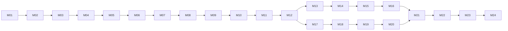

# CAMP-00.04 — Campaign V2 Design Freeze

> Phiên bản khóa: 1.1 — 25/10/2026 (1.0 — 24/10/2026; xem mục 11)
>
> Trạng thái: **FROZEN** cho implementation Campaign V2
>
> Nguồn bắt buộc: [Historical Source Ledger](history-sources.md), [Warlord Matrix](warlord-matrix.md), [Narrative Bible](narrative-bible.md), [Mission Matrix](mission-matrix.md), [Reset Policy](reset-policy.md)

Tài liệu này là hợp đồng kỹ thuật và thiết kế chuẩn cho mọi task triển khai Campaign V2. Từ đây, `M01`–`M24` trong Mission Matrix là bảng canonical. Nếu code, ticket hoặc tài liệu sau mâu thuẫn với freeze này, implementation phải dừng ở phần mâu thuẫn và sửa proposal hoặc tăng phiên bản freeze; không tự diễn giải lại lịch sử, reward hay progression.

Các từ **MUST**, **MUST NOT**, **SHOULD** trong tài liệu này mang nghĩa yêu cầu bắt buộc, cấm và khuyến nghị.

## 1. Cơ sở audit runtime hiện tại

Audit CAMP-00.01 và kiểm tra lại code trước khi khóa thiết kế cho thấy:

- `src/core/campaign/campaign.ts` chứa một catalog tuyến tính 13 `CampaignStage`; stage vừa mang nội dung, encounter, reward, lời thoại, unlock companion và dữ liệu dùng lại cho mode khác.
- `src/core/progress/campaignState.ts` lưu `cleared`, `bestTurns`, `food` và `raids` chung một object. Raid hiện mở bằng old stage ID.
- `src/server/battles.ts` nhận `stage`/`raid`, kiểm tra unlock, tạo trận và settlement Campaign/Raid trong pipeline battle dùng chung.
- `src/core/campaign/raids.ts` lấy `RAID_STAGES` trực tiếp từ `CAMPAIGN`. Tower, Survival, Daily và Arena cũng dùng stage fighter, boss catalog hoặc home terrain từ nhánh này.
- `Profile` lưu account economy và nhiều mode chung: vàng, companion, gear, đá, Song Tháp, Survival, Quest. Campaign reset không được thay hoặc xóa các trường đó.
- Leaderboard, achievement, quest và shop hiện suy ra điều kiện từ `campaign.cleared` hoặc old stage ID.

Hệ quả: xóa thẳng catalog 13 stage sẽ làm hỏng Raid và có thể làm hỏng các mode PvE khác. Implementation MUST dựng catalog/adapter dùng chung và chuyển consumer trước khi gỡ old Campaign catalog. Battle Engine không thuộc phạm vi thay đổi.

## 2. Canonical scope

Campaign V2 có đúng **6 chương, 24 nhiệm vụ**, bốn nhiệm vụ mỗi chương:

| Chương | Mission | Điểm khóa chương |
|---|---|---|
| I — Hoa Lư dựng cờ | M01–M04 | Hoa Lư đứng vững sau cuộc tiến quân năm 951 |
| II — Cửa Bố kết minh | M05–M08 | Trần Lãm và Đinh Bộ Lĩnh là liên minh; không có duel chinh phục |
| III — Nhà Ngô rạn vỡ | M09–M12 | Bối cảnh hậu 965 và hai kết cục quy phục |
| IV — Miền tây tự giữ | M13–M16 | Một nhánh chiến dịch theo địa lý |
| V — Vòng cung phía đông | M17–M20 | Nhánh địa lý song song với chương IV về mặt chronology lịch sử |
| VI — Về một mối | M21–M24 | Năm 968 lên ngôi, quốc hiệu Đại Cồ Việt, định đô Hoa Lư |

### 2.1 Mission identity

- Public mission IDs là chính xác `M01` đến `M24`, viết hoa, zero-padded và không tái sử dụng.
- Namespace/version nằm ở state và API (`campaignVersion: 2`), không nối vào mission ID.
- Old stage IDs không phải alias của M IDs. Adapter chỉ được dùng để giữ Raid hoặc consumer cũ hoạt động; không được tự quy đổi old Campaign completion thành V2 completion.
- Tên, type, historical basis, hook, stakes, outcome và presentation choice lấy từ `mission-matrix.md`. Không được đổi meaning khi đưa vào data runtime.

### 2.2 Progression graph



Quy tắc unlock:

- M01 mở mặc định cho profile đủ điều kiện vào Campaign.
- M02–M12 yêu cầu mission đứng ngay trước đã complete.
- Sau M12, M13 và M17 cùng mở. M14–M16 tuyến tính trong nhánh tây; M18–M20 tuyến tính trong nhánh đông.
- M21 yêu cầu **cả M16 và M20**. M22–M24 tiếp tục tuyến tính.
- Chương IV và V là hai tuyến địa lý phục vụ pacing. Việc người chơi hoàn thành nhánh nào trước không phải tuyên bố chronology lịch sử.
- Unlock và completion MUST được tính, xác nhận và lưu phía server. Client chỉ hiển thị trạng thái server trả về.

## 3. Event categories và completion

Runtime dùng năm category ổn định; các type chi tiết trong Mission Matrix là presentation tag:

| Category | Presentation tags | Điều kiện complete |
|---|---|---|
| `story` | `tutorial`, `travel`, `recon` | Server nhận action hoàn tất nội dung hợp lệ sau khi mission đã unlock |
| `battle` | `defense`, `joint-operation`, `campaign-battle` | Server settlement một battle win gắn đúng mission và event ID |
| `diplomacy` | `diplomacy` | Server nhận một choice ID nằm trong allowlist của mission |
| `aftermath` | `escort`, `defense` | Catalog mission khai báo `story` transaction hoặc standard battle win; không tạo luật combat mới |
| `ceremony` | `ceremony`, `council` | Server nhận action hoàn tất nội dung hợp lệ; không battle bắt buộc |

Invariants:

1. Completion là server-authoritative, monotonic và idempotent. Cùng một event/request không thể complete hoặc phát thưởng hai lần.
2. Battle mission dùng Battle Engine và điều kiện thắng chuẩn đang có. V2 không thêm AI, match-3 objective, timer, nghề/nguyên tố, skill hay luật combat toàn game.
3. Choice chỉ đổi lời đáp, vignette, camera hoặc codex panel. Choice không đổi mission graph, đối thủ, reward, recruit, kết quả lịch sử hoặc ending.
4. Historical claim phải trỏ tới claim ID/source note đã khóa. Lời thoại là `fictional`; không trình bày như trích dẫn nguyên văn.
5. Story/diplomacy/council/ceremony không được tạo battle giả để đi qua API cũ.

## 4. Reward contract

### 4.1 Guaranteed first-clear gold

| Mission | Gold | Mission | Gold | Mission | Gold | Mission | Gold |
|---|---:|---|---:|---|---:|---|---:|
| M01 | 50 | M07 | 250 | M13 | 150 | M19 | 150 |
| M02 | 50 | M08 | 50 | M14 | 150 | M20 | 250 |
| M03 | 250 | M09 | 50 | M15 | 250 | M21 | 250 |
| M04 | 250 | M10 | 50 | M16 | 250 | M22 | 150 |
| M05 | 75 | M11 | 150 | M17 | 250 | M23 | 50 |
| M06 | 150 | M12 | 150 | M18 | 250 | M24 | 300 |

- Tổng mission first-clear gold: **3,975**.
- Hoàn tất đủ bốn mission của mỗi chương phát **250 gold**, một lần mỗi chương; tổng chapter bonus **1,500**.
- Tổng guaranteed Campaign V2 gold: **5,475**.
- Mission và chapter reward phải được ghi cùng transaction/CAS với completion marker tương ứng. Retry hoặc request đồng thời trả về kết quả đã settle, không cộng lại.
- Campaign MUST NOT phát Đá Cường Hóa. Campaign không có guaranteed gear hoặc Raid gear.
- Battle mission có thể tiếp tục nhận reward/drop chuẩn của battle pipeline nếu policy dùng chung đang áp dụng; đó không phải Campaign first-clear reward và không được sửa thông số trong task Campaign.
- Replay không phát lại mission gold, chapter bonus hoặc recruit. Story có thể xem lại không reward; battle có thể replay theo policy battle chung.

### 4.2 Recruit milestones

Roster unlock là phần thưởng gameplay, không phải khẳng định thời điểm nhân vật lịch sử gia nhập. UI MUST dùng “Mở khóa đồng hành”, không dùng cảnh hoặc câu xác nhận “gia nhập vào năm/trận này”.

| Chapter complete | Mission chốt | Companion mở khóa |
|---|---|---|
| I | M04 | Đinh Liễn |
| II | M08 | Nguyễn Bặc |
| III | M12 | Đinh Điền |
| IV | M16 | Lưu Cơ |
| V | M20 | Trịnh Tú |
| VI | M24 | Lê Hoàn |

Server MUST grant recruit trong cùng settlement với chapter milestone. Nếu companion đã tồn tại, giữ nguyên level, XP, SP và gear; không tạo bản sao, không hạ cấp và không phát compensation. Companion mới nhận level bằng level nhân vật chính tại thời điểm grant, XP/SP tương ứng theo helper progression dùng chung và không có gear tự sinh.

## 5. Role of Raids và 12 sứ quân

Raid là mode boss lặp lại độc lập, **không phải một trong 24 mission** và không được chặn Campaign ending. Ba tier, AI difficulty, level bonus, home terrain, gold/gear reward và luật chiến đấu Raid hiện tại nằm ngoài scope cân bằng của Campaign V2.

Mỗi boss Raid mở sau milestone narrative tương ứng:

| Boss | Unlock | Classification trong story |
|---|---|---|
| Trần Lãm | M08 | liên minh; Raid là sparring/what-if, không phải chinh phục |
| Phạm Bạch Hổ | M11 | quy phục |
| Ngô Xương Xí | M12 | quy phục/reconstructed |
| Ngô Nhật Khánh | M13 | quy phục/disputed details |
| Nguyễn Khoan | M14 | tan rã/chưa chắc |
| Kiều Công Hãn | M15 | đánh dẹp tổng thuật |
| Kiều Thuận | M16 | đánh dẹp tổng thuật |
| Lý Khuê | M17 | đánh dẹp tổng thuật |
| Nguyễn Thủ Tiệp | M18 | đánh dẹp tổng thuật |
| Lữ Đường | M19 | quy phục theo nguồn confidence vừa–thấp |
| Nguyễn Siêu | M20 | đánh dẹp tổng thuật |
| Đỗ Cảnh Thạc | M21 | đánh dẹp; không gọi là trận cuối chắc chắn |

Implementation MUST tách một `WarlordEncounterCatalog` (hoặc adapter tương đương) khỏi old `CAMPAIGN` trước khi xóa stage cũ. Raid IDs và Raid progress nên được giữ ổn định; old stage ID có thể tồn tại như encounter ID nội bộ. Tower, Survival, Daily và Arena phải đọc catalog/adapter này, không đọc mission V2.

## 6. Planned schema và transaction boundaries

Đây là shape logic đã khóa; tên type/file vật lý có thể đổi nếu vẫn giữ semantics:

```ts
type CampaignMissionId =
  | "M01" | "M02" | "M03" | "M04" | "M05" | "M06"
  | "M07" | "M08" | "M09" | "M10" | "M11" | "M12"
  | "M13" | "M14" | "M15" | "M16" | "M17" | "M18"
  | "M19" | "M20" | "M21" | "M22" | "M23" | "M24";

interface MissionCompletion {
  readonly completedAt: number;       // server timestamp
  readonly eventId: string;           // idempotency/audit key
  readonly bestTurns?: number;        // battle mission only
  readonly choice?: string;           // allowlisted presentation choice only
}

interface CampaignV2State {
  readonly version: 2;
  readonly completed: Partial<Record<CampaignMissionId, MissionCompletion>>;
  readonly claimedMilestones: readonly string[]; // chapter reward + recruit dedupe
  readonly food: number;
}

interface RaidState {
  readonly version: 1;
  readonly tiers: Readonly<Record<string, number>>;
}
```

Catalog mission MUST khai báo `id`, `chapter`, `category`, presentation tag, prerequisites, completion kind, first-clear reward và optional battle encounter key. Narrative/source data nên giữ reference tới basis/claim ID để validation bắt được mission thiếu nguồn.

`completed`, gold delta, chapter milestone và recruit grant phải commit atomically trong profile update/transaction. `eventId` phải unique trong phạm vi owner và không được dùng để settle hai mission khác nhau. Server phải từ chối unknown mission, locked mission, choice ngoài allowlist, payload trộn Campaign mission với Raid, và battle result không khớp match đã tạo.

Food thuộc Campaign và được phép reset theo [Reset Policy](reset-policy.md). Exact food economy tiếp tục dùng giá trị hiện tại cho đến khi một task riêng được duyệt; task triển khai V2 không được âm thầm rebalance.

## 7. Compatibility contract

Breaking change được chấp nhận trong boundary Campaign: thay 13 stage bằng 24 mission, đổi ID, state shape, Campaign endpoint/UI, Campaign leaderboard/achievement và xóa progress Campaign development theo policy. Không cần migrate completion cũ sang M IDs.

Mọi shared consumer phải có adapter và regression trước khi old symbol bị xóa:

| Boundary | Adapter/behavior bắt buộc | Regression tối thiểu |
|---|---|---|
| Battle API/store | Discriminated payload/metadata cho `campaignMission`; giữ legacy `stage + raid` tới khi Raid chuyển xong; reject mixed payload | create/settle Campaign và Raid; duplicate settlement |
| PvE boss catalog | Catalog độc lập cho 12 boss, fighter config và terrain | Tower, Survival, Daily, Arena cùng seed/setup trước và sau extraction |
| Profile parser | Đọc state V2; tách/preserve legacy Raid; giữ mọi shared field | round-trip gold, bag, loadout, companion, stone, Tower, Song Tháp, Survival, Quest |
| Shop/roster | Map unlock 12 warlord sang milestone M08–M21; giữ price/stats ngoài task | locked/unlocked boundary và companion dedupe |
| Leaderboard | Namespace `campaign:v2` và mission board mới; không nhập old score | Campaign board mới, Tower/Survival boards không đổi |
| Quest/achievement | Đếm đúng battle win hoặc mission completion theo semantics mới; Raid không giả là story completion | progress từng mode, không double count Raid/Campaign |
| HTTP/UI | Render event category đúng; server là source of truth | locked routes, reload/retry, stale client response |

Không được xóa old catalog cho tới khi search không còn shared consumer trực tiếp và regression của consumer đó pass. Battle Engine snapshots phải không đổi. Không chạy hoặc chỉnh balance toàn game trong Campaign implementation.

## 8. Invariants bắt buộc

1. Có đúng 24 mission canonical và đúng progression graph ở mục 2.
2. 951, liên minh Bố Hải, tuyến địa lý 965–967 và đăng quang 968 giữ đúng Narrative Bible; không dựng chronology không có nguồn.
3. Trần Lãm không bị đánh bại trong story Campaign. Raid Trần Lãm mang nhãn challenge hư cấu.
4. Completion, reward, recruit và choice đều server-authoritative, atomic và chống nhận hai lần.
5. Campaign không phát Đá Cường Hóa và không đổi giá trị thưởng đá ở nơi khác.
6. Choice không đổi lịch sử, unlock, economy hoặc ending.
7. Campaign reset không chạm shared profile hoặc progress mode khác.
8. Battle Engine, AI, board/match-3, profession/element, skill, timer và luật combat toàn game không đổi.
9. Raid/Tower/Survival/Daily/Arena không phụ thuộc mission V2 và giữ behavior qua adapter.
10. Mọi fictional/reconstructed content giữ nhãn; recorded claim phải có source ledger reference.

## 9. Accepted changes và rejected changes

### Accepted trong Campaign V2

- Thay toàn bộ Campaign UI/route/data 13 stage bằng sáu chương và 24 mission.
- Đổi Campaign IDs và schema; xóa progress Campaign development theo reset policy.
- Thêm story/diplomacy/aftermath/ceremony flow không cần battle.
- Thêm Campaign-only APIs, state version, idempotency và leaderboard namespace.
- Extract adapter/catalog để giữ mode dùng chung hoạt động.
- Sửa Campaign shop/recruit/unlock mapping theo milestone đã khóa.

### Rejected khỏi scope

- City-builder, quản lý thành trì/thuế/dân số hoặc bản đồ lãnh thổ mô phỏng.
- Multiplayer/co-op/PvP Campaign hoặc shared world progression.
- Choice làm thay đổi kết quả lịch sử, mission graph, người thắng, năm 968 hoặc ending.
- Thay AI, match-3, nghề/nguyên tố, skill, timer, battle rules hay combat balance toàn game.
- Rebalance Raid, Tower, Survival, Daily, Arena, Shop economy, gear hoặc Đá Cường Hóa.
- Xóa account/profile, vàng đã có, companion, gear, đá, Song Tháp, Survival hoặc dữ liệu production.
- Tuyên bố thứ tự đánh dẹp M11–M21 là chronology chắc chắn hay biến chi tiết fictional thành chính sử.

## 10. Gate cho task implementation

Mỗi task triển khai MUST:

1. Link tới phiên bản freeze này và nêu mục/invariant được thực hiện.
2. Liệt kê boundary shared bị chạm và adapter/regression tương ứng.
3. Chứng minh server-authoritative/idempotent nếu task chạm completion, reward, recruit hoặc choice.
4. Chứng minh Campaign reward không làm tăng Đá Cường Hóa.
5. Dừng và đề xuất amendment nếu cần đổi graph, reward table, recruit map, Raid role, history classification hoặc non-goal. Amendment phải tăng phiên bản freeze và ghi lý do trước khi code phụ thuộc được merge.

## 11. Amendments

### 1.1 — 25/10/2026 (CAMP-07.01)

- M22 đổi tên hiển thị thành **Giang Sơn Một Mối** và dùng nhánh `story` transaction của category `aftermath` (mục 3), không còn trận phòng thủ. Lý do: task CAMP-07.01 yêu cầu M22 là chương chuyển tiếp tổng kết 12 vùng, không gọi là trận match-3, không tạo đối thủ giả.
- Choice allowlist M22 đổi từ `disarmFirst`/`rescueFirst` sang `reviewDossiers`/`hearTheRegions`; cùng outcome, chỉ khác vignette.
- Không đổi: graph M21 → M22 → M23, thưởng lần đầu 150 vàng, recruit map, Raid role, phân loại lịch sử. Ngoài graph, M22 chỉ mở khi đủ 12 sứ quân có kết cục (CAMP-06.04).

### 1.1 — 25/10/2026 (CAMP-07.02)

- M23 đổi tên hiển thị thành **Kiến thiết kinh đô Hoa Lư**; vẫn là cảnh council không có trận, slug `hoi-quan-hoa-lu` giữ nguyên. Ba lựa chọn giữ allowlist `livelihood`/`army`/`law`, hiển thị là ưu tiên dân, quân, triều nghi; mỗi lựa chọn chỉ cho một câu kết quả bằng chữ.
- Nguồn M23 thêm S04, S08 (nguồn của E00: Đinh Bộ Lĩnh gắn Hoa Lư). UI ghi "Trích đoạn xây dựng quốc gia"; không dùng tranh kiến trúc, và nếu có thì phải ghi là tái dựng.
- Không đổi: graph M22 → M23 → M24, thưởng lần đầu 50 vàng, không timer, không tài nguyên mới.

### 1.1 — 25/10/2026 (CAMP-07.03)

- M24 đổi tên hiển thị thành **Đại Lễ Đăng Quang năm 968**; slug `dai-co-viet-968`, allowlist `armyView`/`hoaLuView`/`dinhLienView`, thưởng 300 vàng, phiếu chương VI và recruit Lê Hoàn giữ nguyên.
- Chiến dịch hoàn thành = server đã ghi M24 (`campaignCompleted`), không đếm số trận thắng. Thêm thành tựu một lần `a.campaign` (500 vàng, số đặt tạm chờ duyệt) và khung kết (biên niên, sổ thế cục, nguồn và ghi công, nút xem lại). Xem lại đại lễ không cộng thưởng.
- 970 (Thái Bình, E11) và khoảng 971 (đặt quan chức, chưa có trong ledger) chỉ là ghi chú nguồn, không nằm trong cảnh 968.

### 1.1 — 25/10/2026 (CAMP-08.04)

- Gỡ hẳn chiến dịch 13 màn cũ theo yêu cầu của Shan (không phải kiểm lại hai chiến dịch). Mục 1 (audit runtime) và mục 7 (giữ legacy `stage + raid` trong giai đoạn chuyển tiếp) là ảnh chụp trước khi gỡ: nay server từ chối mọi payload `stage`, không còn adapter màn cũ.
- `WarlordEncounterCatalog` của mục 5 là `src/core/campaign/warlords.ts` (đủ 12 sứ quân). Raid giữ 3 tier, level bonus, AI difficulty, home terrain, gold/gear reward và luật chiến đấu; Raid ID đổi từ id màn cũ sang id sứ quân (id màn cũ còn làm encounter ID nội bộ), bậc đã thắng chuyển theo. Tower, Survival, Daily, Arena giữ nguyên hành vi (cùng thứ tự, cùng seed ra cùng đối thủ).
- **Đổi Raid role của mục 5 (Shan chốt 25/10/2026): Raid chỉ còn 6 boss**, là 6 sứ quân bị đánh dẹp theo tổng thuật (nhóm `military` của sổ thế cục): Kiều Công Hãn M15, Kiều Thuận M16, Lý Khuê M17, Nguyễn Thủ Tiệp M18, Nguyễn Siêu M20, Đỗ Cảnh Thạc M21. Mỗi trận là tái đấu. Trần Lãm (liên minh), nhóm quy phục (Phạm Bạch Hổ, Ngô Xương Xí, Ngô Nhật Khánh) và nhóm tan rã/chưa chắc (Nguyễn Khoan, Lữ Đường) không có trận Raid, để game không dựng trận đánh với người không bị đánh dẹp. Dòng "Trần Lãm … Raid là sparring/what-if" và các dòng Raid khác của 6 người này trong bảng mục 5 hết hiệu lực; cột Unlock của họ chỉ còn là mốc mở bán ở cửa hàng (`unlockedContent` kind `raid` vẫn giữ làm mốc gặp sứ quân). Thoại nhóm đánh dẹp bỏ các câu khẳng định thêm (ví dụ "mười một sứ quân đã hàng"). Bậc Raid đã lưu của 6 người kia còn trong hồ sơ nhưng không được đọc.
- Bảng xếp hạng chiến dịch tính số nhiệm vụ V2 hoàn thành, tổng lượt chỉ của nhiệm vụ có trận; bảng từng trận là `mission:<M..>`. Nhiệm vụ tuần "thắng trận chiến dịch hoặc đánh trùm" chỉ đếm trận thắng, không đếm hoàn thành sự kiện. Thành tựu Chương I đếm 4 nhiệm vụ Chương I.
