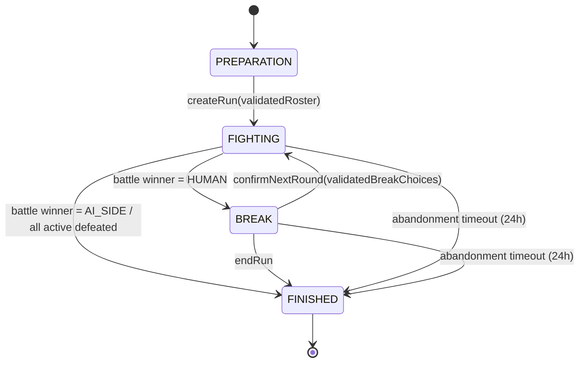

# Survival V1.1 — Rules & State Machine

> Đặc tả hành vi cho đội 3 active + tối đa 2 reserve.
> Tài liệu này chuyển luật đã thống nhất thành hợp đồng để triển khai và kiểm thử. Các ghi chú implementation được rà soát cho Task 24; source hiện hành là căn cứ cuối cùng khi bản đặc tả cũ không còn khớp.
> Căn cứ hiện trạng: [01-current-state-audit.md](./01-current-state-audit.md).

## 1. Phạm vi và thuật ngữ

- **Run**: toàn bộ lượt Sinh tồn, được lưu thành một `Match` online xuyên nhiều wave.
- **Round / wave**: một trận đánh từ lúc bắt đầu round đến khi một phe thắng. Một wave được tính vượt qua khi người chơi thắng trận của wave đó.
- **Roster**: danh sách fighter đã khóa cho run: Đinh Bộ Lĩnh + 2 companion active ban đầu + 0–2 companion reserve. Tối đa 5 ID, không trùng.
- **Active slots**: ba vị trí chiến đấu. Đinh Bộ Lĩnh luôn ở active slot 0; hai slot còn lại là companion. Một fighter gục vẫn chiếm slot cho tới khi được thay ở break.
- **Reserve slots**: tối đa hai vị trí ngoài battle. Reserve không hành động, không bị chọn làm mục tiêu, không tham gia nội tại/tiêu hao lương hay nhận hiệu ứng combat.
- **Break**: thời gian nghỉ sau khi người chơi thắng wave và trước khi wave kế tiếp bắt đầu.
- **Confirm lineup**: thao tác duy nhất áp dụng thay đổi đội hình/cấu hình Đinh Bộ Lĩnh, settlement của break và bắt đầu wave kế tiếp.

## 2. State machine

### 2.1 Trạng thái

Các trạng thái là **trạng thái logic dẫn xuất**, không bắt buộc thêm một enum `phase` vào persisted `Match`:

| Trạng thái | Điều kiện nhận biết | Ý nghĩa |
|---|---|---|
| `PREPARATION` | Chưa tạo Survival `Match`. | Người chơi chọn roster active/reserve; nghề/hệ ban đầu của Đinh Bộ Lĩnh được snapshot từ Profile đã lưu. Muốn đổi build trong run phải đợi BREAK. |
| `FIGHTING` | Có run chưa kết thúc và battle `winner === null`. | Đang đánh một wave. Lineup và nghề/hệ đã khóa tới khi wave kết thúc. |
| `BREAK` | Có run chưa kết thúc và battle `winner === HUMAN`. | Người chơi vừa thắng wave; có thể chuẩn bị lineup kế, đổi hệ/nghề nhân vật chính, hồi sinh, tiếp tục hoặc dừng. |
| `FINISHED` | Run `done === true` hoặc battle kết thúc với `winner === AI_SIDE`. | Run không nhận thêm action gameplay; kết quả cuối lượt được cộng tối đa một lần. |

`winner === HUMAN` chỉ là break đối với Survival chưa `done`; không phải kết thúc Match. `winner === AI_SIDE` kết thúc run ngay. Server phải coi điều kiện battle thắng/thua là nguồn sự thật, không suy ra từ UI hoặc số địch hiển thị.

### 2.2 Sơ đồ chuyển trạng thái

Không có action thay fighter trong `FIGHTING`. Action timeout có thể được xử lý bởi server để kết thúc lượt/AI tiếp tục theo luật trận hiện hành; nó không mở quyền chỉnh đội.

## 3. Action permission matrix

| Action | `PREPARATION` | `FIGHTING` | `BREAK` | `FINISHED` | Điều kiện hợp lệ |
|---|---:|---:|---:|---:|---|
| Tạo run / xác nhận roster đầu lượt | Có | Không | Không | Không | Đúng một main; main là Đinh Bộ Lĩnh; đúng 2 companion active; 0–2 reserve; mọi ID khác nhau và thuộc sở hữu. Server dựng snapshot roster/build từ Profile đã lưu, không cập nhật Profile từ payload Survival. |
| Swap ô / dùng kỹ năng / chọn actor / xoay | Không | Có | Không | Không | Theo luật battle hiện hành, `seq` khớp, người chơi đang có lượt và fighter hợp lệ. Chỉ active fighter trong battle được thao tác. |
| Timeout / server settle / AI action | Không | Có | Không | Không | Theo deadline, grace period và catch-up hiện hành; server quyết định. Không thay roster. |
| Đổi active fighter với reserve | Không | Không | Có, chỉ qua `confirmNextRound` | Không | Có thể thay active companion sống hoặc gục bằng reserve còn sống; active gục không thể giữ slot nếu có reserve sống. Main luôn active slot 0. |
| Đổi nghề/hệ Đinh Bộ Lĩnh | Không | Không | Có, chỉ qua `confirmNextRound` | Không | Chỉ chọn giá trị hợp lệ ở BREAK. Áp dụng cho wave sau; không thay ID nhân vật hoặc Profile. |
| Hồi sinh trả lương | Không | Không | Có, chỉ qua `confirmNextRound` | Không | Chọn một roster fighter đang gục bằng fighter ID; chỉ khi không có auto-revive đủ hạn; lương sau tiếp tế ít nhất 40. |
| Hồi sinh tự động | Không | Không | Tự động trong `confirmNextRound` | Không | Có ít nhất một fighter gục đã đủ hạn; chọn người gục lâu nhất. Không cần lương. |
| Tiếp tục wave kế | Không | Không | Có | Không | Chỉ hoàn tất khi xác nhận thành công; battle winner phải là người chơi và run chưa done. |
| Dừng run | Không | Không | Có | Không | Run chưa done; chốt điểm theo số wave đã vượt qua. Không chạy settlement tiếp wave. |
| Resume / fetch view | — | Có | Có | Có (chỉ xem kết quả) | Chủ sở hữu match; server settle state trước khi trả view. Resume không tạo run hay cộng hồi phục. |

Mọi action ghi trạng thái phải do server xác thực và lưu bằng cơ chế `seq`/compare-and-swap hiện tại. Action sai trạng thái trả lỗi; không được đổi action sai thành thành công rỗng.

## 4. Quy tắc roster và xác nhận đội hình

### 4.1 Roster đầu run

- Run chứa 3 active và tối đa 2 reserve; tổng roster từ 3 đến 5 fighter.
- Đinh Bộ Lĩnh bắt buộc active ở slot 0, không thể bị thay hoặc chuyển reserve.
- Hai active còn lại và reserve phải là companion đã sở hữu, mỗi fighter ID chỉ xuất hiện một lần trong roster.
- Không có tự động chọn reserve. Người chơi chọn reserve trước khi tạo run; nếu không chọn thì roster chỉ có 3 fighter.
- Roster ID cố định đến hết run. Chỉ được hoán đổi vai trò active/reserve cho companion tại break; không thêm/bớt/mua fighter giữa run.

### 4.2 Thay fighter tại break

- Có thể đổi một hoặc cả hai active companion với reserve còn sống. Active companion được rút xuống reserve có thể đang sống hoặc đã gục; HP, energy và `downedAtWave` đi cùng fighter ID, không bị reset.
- Không thể thay/di chuyển Đinh Bộ Lĩnh, đưa reserve gục vào active, hoặc chọn trùng fighter ID. Mọi active được chọn phải thuộc roster khóa và còn sống.
- Nếu active companion gục và còn reserve sống, phải thay fighter gục đó trước khi vào wave tiếp theo. Nếu không còn reserve sống, fighter gục giữ nguyên vị trí.
- Mỗi fighter chỉ có một vị trí trong roster; swap không tạo hoặc xóa fighter.
- Thay đổi trong break là lựa chọn tạm phía client cho đến khi xác nhận. Chỉ request `confirmNextRound` hợp lệ mới commit lineup và settlement vào Match.
- Nếu không có reserve sống, active fighter gục giữ nguyên slot; run có thể tiếp tục với ít hơn ba fighter có thể hành động. Nếu có một reserve sống cho hai active gục, chỉ thay được một; active gục còn lại giữ nguyên.
- Nếu reserve sống nhưng không chọn thay, reserve vẫn ở ngoài trận; không được tự vào sân giữa wave.

Lý do: engine hiện coi mọi `Side.fighters` là combatants. Giữ đúng ba active trong battle side giúp reserve không vô tình nhận lượt, làm mục tiêu, kích hoạt nội tại hoặc thay đổi phép tính lương/energy.

### 4.3 Đổi nghề/hệ Đinh Bộ Lĩnh

- Nghề/hệ tại thời điểm tạo run được snapshot từ Profile đã lưu. Trong Survival run, chỉ đổi tại `BREAK`; trong `FIGHTING` và sau `FINISHED` bị khóa.
- Main luôn giữ ID `dinhBoLinh`, leader index 0 và active slot 0.
- Lựa chọn ở break chỉ có hiệu lực ở wave kế, không sửa fighter state của wave vừa thắng.
- Khi dựng cấu hình main cho wave sau, dùng cùng snapshot progression/loadout đã khóa lúc tạo run, nhưng nghề/hệ đã chọn mới. Không đọc lại thay đổi profile/gear ngoài run.
- Nếu nghề/hệ mới làm max HP khác, sau settlement recovery/revive của wave thắng, quy đổi HP hiện tại theo **tỷ lệ HP trên max HP tại baseline xác nhận build**, làm tròn theo helper HP chuẩn hóa và không tích lũy sai số qua nhiều preview. Fighter đang gục vẫn HP 0; thay nghề/hệ không tự hồi sinh.
- Kỹ năng, passive và stats của nghề/hệ mới áp dụng từ wave kế. Energy và Nộ của phe không bị reset bởi việc đổi nghề/hệ.

Lý do: giữ snapshot run ổn định, tránh thao tác profile ngoài run làm thay đổi sức mạnh giữa chừng; bảo toàn tỷ lệ thương tích khi max HP đổi và không biến đổi nghề thành cách hồi máu miễn phí.

## 5. Round lifecycle và thứ tự xử lý

### 5.1 Từ `PREPARATION` tới round 1

1. Client gửi active companions và reserve companions (có thể rỗng). Nghề/hệ main lấy từ Profile đã lưu, không nhận thay đổi nghề/hệ từ payload tạo Survival.
2. Server xác thực ID, ownership, không trùng, giới hạn 2 reserve; main do server dựng và tự đặt active slot 0.
3. Server chụp cấu hình roster/progression/loadout của run; xác định wave 1 và seed bí mật; tạo battle với đúng ba active, người chơi đi trước.
4. Trạng thái trở thành `FIGHTING`. Resume chỉ fetch cùng Match đã lưu, không quay lại `PREPARATION`.

### 5.2 Kết thúc round hiện tại

- Round kết thúc tại thời điểm battle engine xác lập `winner`.
- `winner === HUMAN`: round đã vượt qua; chuyển sang `BREAK`. `cleared` tăng logic cho wave này ngay khi xác lập thắng, không chờ người chơi bấm tiếp.
- `winner === AI_SIDE`: chuyển `FINISHED`; không có break, hồi phục, tiếp tế, trả lương hồi sinh hay đổi lineup.
- Trong round, reserve không tham chiến. Nếu cả ba active fighter bị hạ trước khi phe người chơi thắng, battle kết thúc thua và run `FINISHED`, dù còn reserve sống.
- Nếu main gục nhưng còn ít nhất một active companion sống, trận vẫn tiếp tục bình thường. Nếu phe người chơi thắng, vào `BREAK`; main có thể được hồi sinh theo luật chung, nhưng không được thay bằng reserve.

### 5.3 Break và `confirmNextRound`

Break cho phép xem trước và chọn thay companion sống/gục, thay hệ/nghề main, chọn fighter trả lương hồi sinh, hoặc dừng. Chưa có hồi HP/tiếp tế/revive được áp dụng ở phía server cho đến khi xác nhận tiếp tục. Khi `confirmNextRound` hợp lệ, server thực hiện **một giao dịch logic theo đúng thứ tự**:

1. **Kiểm tra trạng thái/version:** run chưa done, battle thắng wave vừa rồi, action `seq` khớp; kiểm tra wave ID hiện tại và mọi lựa chọn break.
2. **Chụp vai trò của wave vừa thắng:** dùng active IDs trong `BattleState` và reserve IDs trong roster hiện tại. Vai trò này là nguồn tính recovery; mọi lựa chọn đội hình wave kế không được làm thay đổi tỷ lệ của wave đã xong.
3. **Recovery một lần:** active còn sống hồi `20% max HP`; reserve còn sống hồi `10%`; vai trò được xác định theo lineup đã dùng trong wave vừa thắng, trước rotation tại BREAK. Fighter HP 0 không được heal. Clamp max HP, giữ energy/Nộ và `downedAtWave`; fighter không thể nhận cả hai tỷ lệ trong cùng break.
4. **Tiếp tế:** cộng 25 lương, cap 100. Đây là số lương dùng để xét/thu phí revive.
5. **Chọn tối đa một fighter gục trong toàn roster để hồi sinh:**
   - Nếu có fighter đủ điều kiện tự hồi sinh, chọn người gục lâu nhất; hòa thì theo thứ tự roster ổn định. Auto-revive áp dụng cả active và reserve, ưu tiên hơn mọi lựa chọn trả phí.
   - Nếu không có auto-revive đủ hạn, có thể chọn bất kỳ fighter gục nào, kể cả reserve, và trả 40 lương nếu đủ sau tiếp tế.
   - Không chọn trả phí thì không hồi sinh người chưa đủ hạn.
   - Fighter hồi sinh về `30% max HP`, energy `0`; không nhận thêm active/reserve recovery trong cùng break. Nếu đang ở reserve, tiếp tục ở reserve.
6. **Chốt cấu hình wave kế:** áp dụng các lựa chọn swap/main build hợp lệ (nếu được hỗ trợ); việc thay vị trí không reset hoặc chuyển `downedAtWave`. Fighter reserve được hồi sinh không tự động vào active.
7. **Khởi tạo wave kế:** truyền BattleState đã recovery vào `beginWave` với heal bằng 0; thay phe địch trên board hiện tại, đặt lượt về 1 và người chơi đi trước. Upkeep đầu lượt theo luật hiện hành; beginWave không được cộng thêm recovery.
8. **Ghi nguyên tử:** tăng wave, lưu roster/battle đã settle và sequence mới; action cùng `seq` gửi lại không thể chạy settlement lần hai. `settledThroughWave` bảo vệ thêm khỏi gọi recovery hai lần.

Nếu người chơi chọn `endRun` ở break, server chỉ chốt `done` và thưởng run theo `cleared`; các bước 2–8 không chạy, nên không nhận hồi máu, +25 lương hoặc revive của wave chưa bắt đầu.

### 5.4 Hồi sinh cũ — cách đếm chính xác

- `downedAtWave` lưu trên roster entry theo fighter ID, không phụ thuộc active slot; giá trị không bị thay đổi khi fighter chuyển active ↔ reserve.
- Đủ điều kiện auto-revive tại break sau khi đã hoàn thành một wave đầy đủ tiếp theo kể từ wave bị hạ. Ví dụ: gục wave 3 → break sau wave 3 chưa đủ; nếu vẫn gục sau khi thắng wave 4 thì hồi sinh trong settlement để vào wave 5.
- Mỗi break hồi sinh tối đa một người trong toàn bộ roster 3–5 fighter. Nếu nhiều người cùng đủ điều kiện, chọn người có `downedAtWave` nhỏ nhất; hòa thì dùng thứ tự fighter cố định trong roster từ lúc tạo run, không dùng slot.
- Fighter auto/paid revive đặt `downedAtWave = null` khi xác nhận hồi sinh. Nếu fighter đó lại gục, ghi wave gục mới.
- Reserve gục cũng nằm trong tập xét auto/paid revive; hồi sinh reserve vẫn ở reserve, không tự động vào active. Main luôn active.
- Khi đủ auto-revive, request trả phí bị từ chối với lỗi trạng thái/lựa chọn không hợp lệ; không được dùng phí để hồi sinh người khác thay cho người đến hạn.

## 6. Fighter lifecycle

| Trạng thái fighter | Có hành động/được chọn mục tiêu? | Hồi cuối round thắng | Có thể swap ở break? | Hồi sinh |
|---|---:|---:|---:|---|
| Active, sống | Có | +20% max HP, đúng một lần theo vai trò trong wave vừa thắng | Có thể đổi với reserve sống | Không cần |
| Active companion, gục | Không | Không | Phải đổi với reserve sống nếu có; nếu không giữ slot | Auto theo hạn hoặc trả 40 lương |
| Đinh Bộ Lĩnh, gục | Không; main không thể thay | Không | Không | Auto theo hạn hoặc trả 40 lương |
| Reserve, sống | Không | +10% max HP, đúng một lần theo vai trò trong wave vừa thắng | Có thể đổi vào active ở BREAK | Không cần |
| Reserve, gục | Không | Không | Không thể vào active khi còn gục | Auto theo hạn hoặc trả 40 lương |
| Fighter vừa hồi sinh | Giữ active/reserve role hiện tại | Không nhận hồi thêm trong cùng break | Reserve không tự vào sân; chỉ có thể swap tại break hợp lệ | HP 30%, energy 0; bỏ `downedAtWave` |

Khi fighter bị hạ trong round, chỉ cập nhật HP/downedAt; không tự chuyển vai trò. Chuyển vị trí chỉ xảy ra ở break và không làm fighter hồi máu. Đây là điểm bảo đảm không có đổi tướng giữa round.

## 7. Invariants bắt buộc

1. Một run có đúng một main ID là `dinhBoLinh`; main luôn active slot 0 và leader.
2. Roster gồm 3–5 ID không trùng; có đúng 3 active slots; reserve count từ 0 đến 2.
3. Mỗi roster fighter thuộc đúng một slot active/reserve tại mọi trạng thái đã lưu.
4. `Side.fighters` chỉ chứa ba active, gồm fighter gục nếu họ vẫn ở active; reserve không xuất hiện trong combat state.
5. Fighter identity và `downedAt` không phụ thuộc index slot; swap slot không chuyển lịch sử thương tích sang người khác.
6. Fighter gục không thể được chọn vào active; active companion sống hoặc gục có thể chuyển về reserve, giữ nguyên runtime theo ID.
7. Không có roster/element/profession change trong `FIGHTING`; mọi thay đổi break chỉ có hiệu lực khi confirm thành công.
8. Một wave chỉ được tính cleared khi battle `winner === HUMAN`; không tính wave đang dở khi thua, timeout giữa wave hoặc abandon.
9. Chỉ `BREAK -> FIGHTING` chạy hồi phục/tiếp tế/revive của break; `BREAK -> FINISHED` không chạy.
10. Một transition break được áp tối đa một lần bằng state version/`seq`; cùng một request lặp không cộng hồi phục, lương hay revive lần hai.
11. `FINISHED` là terminal cho action gameplay. `claimReward` hiện có tiếp tục bảo đảm thưởng cuối run chỉ cộng một lần.
12. Board và board RNG giữ nguyên giữa wave; Nộ giữ nguyên; lương mang sang sau +25 và upkeep; energy giữ nguyên ngoại trừ fighter vừa revive về 0; spirit reset 100 mỗi wave.
13. Cả ba active bị hạ trong một round dẫn đến `FINISHED` ngay. Reserve không được tự động tung vào giữa round và không ngăn thất bại đó.

## 8. Tình huống đặc biệt

| Tình huống | Kết quả bắt buộc |
|---|---|
| Main gục, hai companion còn sống | Round tiếp tục; main vẫn active slot 0 nhưng không hành động. Nếu thắng wave, main có thể hồi sinh hoặc tiếp tục gục; không thể thay main bằng reserve. |
| Active companion gục, reserve còn sống | Sau khi settlement recovery theo role wave đã xong, phải swap reserve sống vào slot đó. Fighter gục chuyển xuống reserve với HP 0 và giữ `downedAt`. |
| Active companion gục, không có reserve sống | Không swap; fighter gục giữ active slot. Có thể bắt đầu wave kế với 1–2 active sống; không tự kết thúc chỉ vì thiếu fighter sống. |
| Có một reserve sống cho hai active gục | Có thể thay tối đa một active companion; active gục còn lại giữ slot/HP 0. |
| Không có reserve sống nhưng auto-revive đến hạn | Auto-revive một fighter gục; nếu là active, fighter trở lại active; nếu reserve, vẫn nằm reserve. |
| Auto-revive và người chơi chọn trả revive | Auto-revive được ưu tiên; lựa chọn trả phí bị từ chối. Không hồi sinh người thứ hai. |
| Main gục và đủ điều kiện auto-revive | Main hồi sinh theo thứ tự ưu tiên cũ; vẫn active. Nếu companion reserve cũng đủ hạn, người gục sớm nhất được chọn, không nhất thiết main. |
| Cả ba active gục, reserve còn sống | Run kết thúc thua ngay; không vào break và reserve không cứu run. |
| Người chơi dừng ở break | `cleared` gồm wave vừa thắng; không chạy break recovery/food/revive tiếp wave. Ghi thưởng run theo cơ chế final reward hiện tại. |
| Mất kết nối/F5 trong break | Resume fetch state server; nếu action confirm chưa commit, break vẫn nguyên; nếu đã commit, wave kế đã bắt đầu. Không tin state roster staging từ client như state đã lưu. |
| Hai request confirm cùng lúc | Một request thắng compare-and-swap theo `seq`; request còn lại conflict/stale, fetch state mới. Không settlement hai lần. |
| Bỏ dở quá 24 giờ | `FINISHED` theo luật hiện hành; `cleared` chỉ tính wave hoàn thành. Không hồi phục/tiếp tế/revive cho wave chưa xác nhận. |

## 9. Thưởng và chống áp dụng hai lần

- **Recovery/tiếp tế/revive** là settlement của một break và chỉ xảy ra khi `confirmNextRound` chuyển break sang wave kế. Không settlement ở thời điểm riêng khác (render UI, fetch/resume, timeout, endRun).
- **Vàng Survival** tiếp tục được tính cuối run bằng `SURVIVAL_WAVE_GOLD × cleared`; không cộng vàng ở mỗi break. Như vậy `cleared` là nguồn đếm duy nhất, không có bộ đếm vàng song song cần đồng bộ.
- **Vàng/sách trên bàn** vẫn là số tích lũy trong battle side, không cộng lại khi sang wave.
- **Thưởng cuối run** chỉ áp dụng khi Match kết thúc và claim reward thành công một lần. Kết quả `cleared`, best, quests, leaderboard và phần thưởng không được cộng từ client.
- Thay người trong roster không tạo thêm lượt thưởng. Để giữ behavior tương thích, đặc tả này mặc định XP cuối run tiếp tục theo danh sách fighter active trong battle state lúc kết thúc; reserve không tự nhận XP nếu không active tại thời điểm kết thúc. Đây là bảo toàn quy tắc `reward` hiện tại, không phải luật đã có về reserve.

## 10. Quyết định thiết kế và lý do

| Quyết định | Lý do |
|---|---|
| Dùng trạng thái logic dẫn xuất thay vì thêm `phase` persisted. | Tương thích Match hiện tại: battle winner + `SurvivalRun.done` đủ phân biệt FIGHTING/BREAK/FINISHED; PREPARATION nằm trước khi Match được tạo. Tránh có hai nguồn phase và winner lệch nhau. |
| Chỉ ba active nằm trong `Side.fighters`; reserve ở roster state. | Battle engine xem toàn bộ fighter trong side là combatants và dùng mảng đó cho lượt, target, nội tại, upkeep và reward. |
| Cho phép thay active companion sống hoặc gục tại BREAK. | Hỗ trợ rotation chiến thuật đã yêu cầu, đồng thời giữ trạng thái fighter theo ID; fighter gục chỉ rời active khi có reserve sống thay thế. |
| Main luôn ở active slot 0 kể cả khi gục. | Bảo toàn yêu cầu bắt buộc main active, leader/Nộ gắn với index 0, và không cho reserve thay nhân vật chính. |
| Cho tiếp tục với ít hơn ba active sống khi không còn reserve sống. | Không biến “không còn reserve” thành thua tự động; điều kiện kết thúc duy nhất trong round vẫn là cả ba active bị hạ. Slot active gục được giữ để hồi sinh sau. |
| Auto-revive ưu tiên fighter gục lâu nhất và cấm trả phí cùng break. | Giữ luật “mỗi break tối đa một người”; loại bỏ kết quả phụ thuộc action payload khi UI không nên cho lựa chọn phí nếu auto đã đến hạn. |
| Chọn roster/cấu hình break là provisional đến confirm. | Cho phép người chơi xem và sửa lựa chọn mà không làm state server nửa-chừng; một action server atomically xác nhận lineup, hồi phục và mở wave kế. |
| Recovery theo vai trò lineup ở wave vừa thắng; rotation sau recovery. | Không thể đổi vai trò tại BREAK để nhận nhầm tỷ lệ hồi active/reserve. Fighter được hồi sinh nhận đúng 30%, không cộng thêm recovery trong cùng break. |
| Đổi nghề/hệ main chỉ hiệu lực wave kế và giữ HP theo tỷ lệ. | Không thay đổi kết quả wave đã chơi, tránh heal exploit khi đổi nghề có max HP khác, giữ snapshot progression/gear ổn định. |
| `cleared` tăng ở thời điểm thắng wave; vàng Survival vẫn cộng cuối run. | Khớp semantics hiện tại: thắng wave được tính dù người chơi dừng ngay tại break; không cần trả thưởng từng wave hai lần. |

## 11. Các quyết định thiết kế được chốt trong đặc tả này

Các luật cố định của yêu cầu được giữ nguyên. Những điểm chưa được định nghĩa trong V1 được giải quyết dưới đây thành behavior chuẩn cho V1.1, để implementation và test không phải tự suy đoán:

1. Reserve được tự chọn trước run; không có tuyển/mua thêm fighter giữa run.
2. Có thể thay active companion sống hoặc gục; fighter gục phải được thay nếu reserve sống còn. Thứ tự fighter được chọn ở active slots là thứ tự lineup đã xác nhận, nhưng main luôn slot 0.
3. Có thể vào wave kế với 1–2 active sống khi reserve không đủ; run chỉ thua khi cả ba active bị hạ trong round.
4. Auto-revive áp dụng cả reserve và ưu tiên cao hơn lựa chọn trả phí.
5. XP cuối run chỉ cho active lineup tại thời điểm kết thúc để bảo toàn cách tính hiện tại; reserve không active lúc kết thúc không nhận XP.
6. Main đổi class/element tại break dùng snapshot progression/gear và giữ HP theo tỷ lệ khi max HP thay đổi.

Các điểm trên là normative cho đặc tả V1.1. Nếu có thay đổi gameplay sau này, cập nhật mục này và bộ test chấp nhận cùng lúc; implementation không được tự chọn behavior khác.

## 12. Bộ kiểm thử chấp nhận tối thiểu

1. PREPARATION từ chối thiếu main, main sai ID, companion không sở hữu/trùng, trên 2 reserve; chấp nhận không có reserve.
2. FIGHTING không nhận action đổi lineup hoặc đổi nghề/hệ; reserve không có actor/target.
3. Thắng wave vào BREAK và tính `cleared` đúng một lần; thua khi active bị quét sạch vào FINISHED dù reserve còn sống.
4. Main gục nhưng companion thắng được wave; main không thể bị swap, vẫn có thể được auto/paid revive.
5. Active sống hồi đúng 20%; reserve sống hồi đúng 10%; HP bị cap max; fighter gục không nhận hồi.
6. Swap chỉ cho active companion gục ↔ reserve sống; ID và downedAt đi cùng fighter, không theo slot.
7. Đủ điều kiện auto-revive: chọn người gục lâu nhất, tie-break ổn định, không cho trả phí thêm; chưa đủ hạn mới cho trả 40 sau +25.
8. Paid/auto revived fighter về 30% max HP, 0 energy và không nhận heal cùng break; reserve revive ở reserve.
9. Lương cap 100, phí tính sau tiếp tế, upkeep đúng một lần ở đầu wave; lương không bị cộng lần hai khi refresh/retry.
10. Main đổi nghề/hệ ở break chỉ áp wave kế, giữ identity và HP ratio; không cho đổi khi fighting.
11. `confirmNextRound` cùng sequence gửi song song/retry chỉ commit một lần; response stale/conflict không hồi phục/tiếp tế thêm.
12. `endRun` ở break không áp settlement; thưởng cuối run tính cleared, best, vàng và leaderboard một lần.
13. Resume ở FIGHTING/BREAK/FINISHED khôi phục state phía server chính xác; 24h timeout chỉ tính wave hoàn thành.

## Kết quả: PASS

State machine, điều kiện action, thứ tự settlement, vòng đời fighter và các edge case được định nghĩa thành hợp đồng triển khai/kiểm thử. Các điểm V1 chưa quy định được chốt thành behavior chuẩn ở mục 11.
