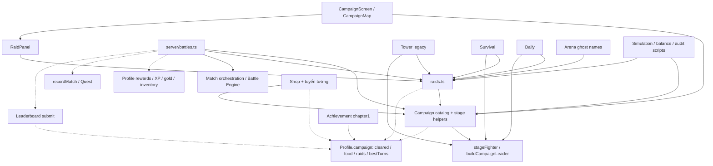

# CAMP-00.01 — Audit Campaign hiện tại và kiến trúc Campaign V2

Ngày: 2026-10-24 (Asia/Saigon). Repository: `ShanChen6/Reed-Banner`.
Snapshot audit: `b99f94316b1d84c185874b43096c8eff58439618`.
Phạm vi: audit-only; không triển khai V2, không đổi Battle Engine, không đổi dữ liệu chế độ khác, không commit/push/deploy.

## 1. Current architecture

### Catalog và progression

Đã đọc toàn bộ `src/core/campaign/`: `campaign.ts`, `raids.ts`, `index.ts`; `src/core/progress/campaignState.ts`; toàn bộ `src/server/battles.ts`; ba component Campaign và các consumer liên quan.

- `campaign.ts:CAMPAIGN` là mảng phẳng 13 màn, một chương “Cờ lau dẹp loạn”. Thứ tự mảng cũng là luật mở khóa: chỉ cần màn liền trước trong `cleared`. Không có entity chapter, mission hay prerequisite riêng.
- IDs theo thứ tự: `coLau`, `boHai`, `dangChau`, `binhKieu`, `duongLam`, `tamDai`, `phongChau`, `hoiHo`, `sieuLoai`, `tienDu`, `teGiang`, `tayPhuLiet`, `doDong`.
- Ba màn đầu 1v1; mười màn sau 3v3; cấp đối thủ 1–20, cấp gợi ý 4–24. `doDong` có boss HP ×1,5; một số màn sửa lương AI và spawn weights.
- `CampaignStage` trộn nội dung kể chuyện, địa danh, đội địch, thiết lập trận, thưởng vàng và tuyển tướng. `StageFoe.hero` chỉ preset thủ lĩnh AI, không phải quyền sở hữu tướng.
- `stageFighter` dựng thủ lĩnh bằng `buildCampaignLeader` rồi thêm signature; tùy tướng dùng `BASE_STATS`, kỹ năng nghề và `leveledFoe`. Đây là factory đang được nhiều mode sử dụng, không thể coi là riêng Campaign.
- `applyCampaignResult` ghi first clear, vàng thưởng, lương carry-over, best turns và companion mới. Thắng lại không nhận lại thưởng first clear; best turns chỉ giảm khi thắng. Thua vẫn cập nhật lương.
- Lương khởi đầu 60, clamp 20–100; `buyFood` trong `progress/profile.ts` đổi 3 vàng/điểm. Lương này riêng Campaign; không phải lương của Tower hoặc Raid.
- `CampaignState = {cleared, food, raids, bestTurns}`. `raids` nằm chung state dù là chế độ riêng. `parseCampaign` lọc kiểu và range nhưng không kiểm tra ID tồn tại, prerequisite hay bestTurns tương ứng cleared.

### Luồng server, lưu trữ, phần thưởng

1. `POST /api/battles` dùng `parseNewBattle`: `stage` tra catalog; server suy ra mode/difficulty; `raid` là tier tùy chọn đi cùng stage. Parser có các nhánh arena/daily/survival/tower trước nhánh stage.
2. `createBattleFor` kiểm tra sở hữu companions, dựng team từ Profile, kiểm tra `stageUnlocked` hoặc `raidUnlocked`, dựng foes/rules rồi gọi `startMatch`. Campaign dùng `profile.campaign.food`; Raid dùng lương riêng mặc định và AI đầy lương.
3. Match mang `stage?: string`, `raid?: RaidTier`; các trường này đi qua config, Match, MatchView trong `src/core/match/match.ts`. Client lưu match ID trong localStorage để resume.
4. `reward` claim quyền thưởng qua `MatchStore.claimReward`, rồi áp `battleRewards`, XP/vàng thường, quest và thưởng riêng Campaign/Raid/Tower/Survival; drop thường độc lập với drop first-clear Raid. Không thể thay toàn bộ reward pipeline để làm V2.
5. `ProfileStore` ghi lạc quan bằng version và retry tối đa 3 lần. PostgreSQL lưu Profile ở `profiles.data` JSONB, Match ở `matches.state` JSONB; không có bảng Campaign riêng (`server/db/schema.ts`). Đổi shape Campaign không mặc nhiên cần đổi DDL.
6. `submitProfile` upsert leaderboard sau khi ghi thưởng thành công; lỗi leaderboard được log, không rollback thưởng.

Điểm yếu sẵn có: claim thưởng và ghi Profile là hai bước; nếu claim thành công nhưng cập nhật Profile thất bại, lần sau không tự claim lại. Đây là rủi ro của pipeline chung, không sửa trong audit này.

### Giao diện

- `CampaignScreen.tsx` fetch Profile, tự chọn màn tiếp theo, hiển thị danh sách phẳng, detail, RaidPanel và doanh trại. Header cố định chương 1. Start gửi `stage` và tùy chọn `raid` với đội từ Profile.
- `CampaignMap.tsx` là SVG vùng châu thổ sông Hồng; `STAGE_POS` chứa 13 ID cũ. ID không có tọa độ rơi về cùng một điểm `[105.8,20.9]`; chỉ thay catalog sẽ làm các node chồng nhau.
- `RaidPanel.tsx` nhận `CampaignStage`, đọc `profile.campaign.raids` và cleared; Raid hiện chỉ truy cập qua màn Campaign tương ứng.
- `DemoGame.tsx` tra `stageById` để hiện thoại cuối trận, thưởng Campaign, lương và tướng mới; `online.ts` mang DTO stage/raid/outcome.
- `ShopPanel.tsx` tra `CAMPAIGN` để mô tả cả tướng gia nhập lẫn điều kiện mở bán. `LeaderboardScreen.tsx` dùng catalog để chọn bảng từng màn. `MenuScene.tsx` mô tả “Bản đồ 12 sứ quân”.

## 2. Dependency graph

Mũi tên A → B nghĩa là A đọc/gọi/phụ thuộc B; các mũi tên nét đứt là phụ thuộc tiến trình hoặc side effect.



### Phân loại và ảnh hưởng

| Consumer / nguồn bằng chứng | Phụ thuộc cụ thể | Phân loại / yêu cầu V2 |
|---|---|---|
| `core/campaign/campaign.ts` | catalog, chuyện, thứ tự mở, first clear, lương, joins | Riêng Campaign, được thay mới |
| `core/campaign/raids.ts` | `RAID_STAGES = CAMPAIGN.filter(first foe.hero)`; stage lookup; level/recommended/mode; `BOSS_HP`; terrain; tier/reward | Boss Raid riêng mode nhưng đang ghép Campaign; giữ 12 boss, 3 tier và số liệu |
| `core/tower/tower.ts:109` | chọn boss theo RNG/index của `RAID_STAGES`, `stageFighter`, `BOSS_HP`, `HOME_TERRAIN` | Dùng chung; không đổi pool/thứ tự/RNG/stat/terrain |
| `core/survival/survival.ts:1754` | pool boss, fighter factory, HP multiplier | Dùng chung; bảo toàn kết quả cùng seed/baseLevel/wave |
| `core/daily/daily.ts:66` | pool, factory, terrain; trả `stage` cho tên đất | Dùng chung; giữ đề cùng seed; DailyScreen hiện tra tên bằng stageById |
| `core/arena/arena.ts:106` | region từ pool để đặt tên ghost | Phụ thuộc metadata; đổi pool/thứ tự cũng đổi tên cùng seed |
| `core/progress/leaderboard.ts` + server/db leaderboard | count cleared, tổng bestTurns; `campaign`, `stage:<id>` | Adapter Campaign phải đổi; Tower/Survival/Arena/Destiny boards giữ nguyên |
| `core/progress/quests.ts:recordMatch` | win Campaign hoặc Raid tăng stat `campaign`, cả replay | Contract chung phải giữ, 24 mission không phải 24 QuestDef |
| `core/progress/achievements.ts` | `CHAPTER1_STAGES = 13`, `a.chapter1` đếm toàn bộ cleared | Riêng achievement Campaign cần thay; không sửa thành tựu mode khác |
| `core/progress/profile.ts` | new/parse Campaign, buyFood, shopUnlocked, buyCompanion | Shared aggregate; chỉ thay nhánh/adapter Campaign |
| `core/roster/roster.ts:WARLORD_COMPANIONS` | 12 trường stage ID; shopUnlockStage | Shared roster; giữ fighter ID, nghề, hệ, giá; đưa gate V2 ra policy riêng |
| `core/campaign/campaign.ts:applyCampaignResult` | 6 hero auto-join, cấp theo stage, XP/skill points | Riêng policy Campaign; companion sau khi nhận dùng ở mọi mode |
| `core/progress/progress.ts:buildCampaignLeader` | preset AI cũ | Dùng chung qua factory; giữ hành vi cho mode khác |
| `core/sim/campaign.ts`, `core/sim/audit.ts`, `scripts/balance.ts` và audit scripts | IDs cũ, thứ tự joins, stage API, baseline count | Tooling riêng catalog lẫn regression engine; không sửa engine để làm test qua |
| `core/match/match.ts` | metadata stage/raid và type import RaidTier | Shared orchestration, không phải Battle Engine; ưu tiên adapter không đổi contract |

### Tuyển tướng hiện tại

Auto-join: `coLau → nguyenBac`, `boHai → dinhDien`, `dangChau → luuCo`, `binhKieu → trinhTu`, `tamDai → leHoan`, `phongChau → dinhLien`. Chỉ first clear và chưa sở hữu mới thêm; cấp bằng cấp màn, kỹ năng chưa phân bổ, không bán trong Shop.

Mở bán: `boHai → tranLam`, `dangChau → phamBachHo`, `binhKieu → ngoXuongXi`, `duongLam → ngoNhatKhanh`, `tamDai → nguyenKhoan`, `phongChau → kieuCongHan`, `hoiHo → kieuThuan`, `sieuLoai → lyKhue`, `tienDu → nguyenThuTiep`, `teGiang → luDuong`, `tayPhuLiet → nguyenSieu`, `doDong → doCanhThac`. Hiện giá mỗi sứ quân 3000, mua ở cấp 1. Không được nhầm unlock bán với grant ownership.

## 3. Breaking changes cần thực hiện khi triển khai

| Contract hiện tại | Thay đổi đề xuất | Consumer phải cập nhật |
|---|---|---|
| 13 stage IDs và mảng phẳng | 6 chapter, 24 mission IDs mới; tham chiếu prerequisite rõ ràng | Campaign UI, server lookup, sim, fixtures, docs |
| `CampaignState` không version | state version 2, completion records theo mission | newProfile/parseProfile, DTO, reward, leaderboard, Shop gates |
| raids nằm trong Campaign | Tách ownership/module trước; phương án đầu giữ storage legacy để không reset mode khác | Raid adapter/UI, parser; chưa cần di chuyển persisted Raid state |
| `stage + raid?` cùng lookup | Tách resolver Campaign V2 và Raid legacy | parser/create/reward, online DTO, kết quả battle |
| `CampaignStage.joins` đơn | rewards có grant hero rõ cấp; unlock shop/raid theo policy | settlement, Shop text, simulation |
| achievement 13 màn | achievement theo completion set của từng chapter | achievements và quest UI; chỉ mục Campaign |
| board `stage:<id>` | dùng mission ID hợp lệ và allowlist catalog V2 | validator, boardScores, dropdown; dọn board Campaign cũ có chọn lọc |
| SVG 13 tọa độ | chapter navigation và node layout có dữ liệu riêng | CampaignMap/Screen, menu copy |
| thoại tra catalog duy nhất | resolver theo loại trận, catalog đúng phiên bản | DemoGame và DailyScreen |

Chọn ID dạng `c2ch01m01` … `c2ch06m04` (24 ID) để không xung đột ID Raid cũ và tương thích regex board hiện tại `[A-Za-z0-9]{1,40}`. Không bắt buộc dùng dấu `-`/`:`; nếu dùng phải cập nhật validator có chủ đích. Phân bổ 4 nhiệm vụ/chương là đề xuất, chưa có đặc tả nội dung xác nhận.

Không cần migration bảo toàn Campaign cũ. Có thể reset riêng slice Campaign khi version khác 2; không reset toàn bộ Profile, Raid, Tower, Survival, Arena, Daily, Trial hoặc Destiny. Vàng/tướng từng nhận là tài sản dùng chung: mặc định giữ, settlement không cấp lại hero đã có; chiến dịch mới có first-clear rewards mới. Không tự thu hồi hoặc reset tài sản trong task này.

## 4. Đề xuất cấu trúc mới

```text
src/core/pve/                       # nền dữ liệu/factory dùng chung, bảo toàn snapshot cũ
  warlords.ts                      # 12 preset, thứ tự, metadata cũ
  fighters.ts                      # factory giữ nguyên preset/skill behavior
  terrain.ts                       # HOME_TERRAIN, HOME_RULE, boss multiplier cũ
src/core/raid/                      # catalog Raid độc lập Campaign V2
  catalog.ts                       # 12 encounter cũ với IDs cũ
  rules.ts                         # 3 tiers, setup/reward nguyên trạng
src/core/campaign/
  types.ts                         # Chapter, Mission, Reward, prerequisite
  content/chapters.ts               # 6 chương, không import Profile
  content/ch01.ts ... ch06.ts       # tổng 24 nhiệm vụ
  catalog.ts                       # index, lookups, validation
  progression.ts                   # prerequisite/chapter completion selectors
  setup.ts                         # Mission -> config hiện có của startMatch
  rewards.ts                       # settlement riêng Campaign
  unlocks.ts                       # mapping mission -> shop/raid gate
  index.ts
src/core/progress/campaignState.ts  # state version 2 + parser, không import catalog
src/server/campaign.ts             # adapter create/settle riêng Campaign
src/app/game/campaign/
  CampaignScreen.tsx               # điều hướng chapter
  ChapterMap.tsx                   # layout theo dữ liệu chương
  MissionDetail.tsx
  CampaignCamp.tsx
```

Đây là cấu trúc đề xuất, không phải danh sách file đã tạo. Việc chuyển module dùng chung chỉ đổi ownership/import; không đổi values, thứ tự pool hay số lần gọi RNG. Có thể dùng re-export tương thích tạm thời nhưng consumer mode khác phải đi đến catalog frozen, không dẫn ngược tới V2.

### Schema và invariant đề xuất

```ts
type CampaignV2State = {
  version: 2;
  completed: Readonly<Record<MissionId, { bestTurns: number }>>;
  food: number;
};
// RaidState tiếp tục được quản lý riêng; không nằm trong CampaignV2State.
// Bước đầu có thể giữ profile.campaign legacy cho Raid adapter và thêm profile.campaignV2.
```

Khuyến nghị bước đầu dùng `Profile.campaignV2` để tách reset Campaign khỏi `Profile.campaign.raids`; field legacy không còn là nguồn Campaign UI/BXH/Shop. Khi có task schema Raid riêng mới chuyển sang `Profile.raid`; audit này không đề xuất reset Raid hoặc sửa dữ liệu mode khác.

- Chapter có `id`, `order`, `title`, `missionIds`, layout; mission có `id`, `chapterId`, `order`, `requires`, story/lines, battle config và firstClear rewards.
- Completion và chapter completion chỉ có một nguồn dữ liệu: chapter complete suy ra từ tất cả mission trong chapter; không lưu thêm count/unlocked dễ lệch nhau.
- Giữ win condition hiện có là thắng trận. Nếu thiết kế đòi escort, nhiều wave hoặc mục tiêu đặc biệt cần đặc tả/task riêng; không tự thêm vào Battle Engine.
- Content thuần dữ liệu; state parser chỉ kiểm tra shape/version. Catalog-aware validation/selection ở lớp Campaign, tránh vòng import `progress → campaign → progress` đang được ghi chú trong achievements.
- Validate 6 chapter, 24 mission, unique IDs, foreign keys, DAG prerequisite, có điểm bắt đầu, mọi mission reachable; foes/mode tương thích engine, hero IDs tồn tại, layout đầy đủ và grant/gate không trỏ ID cũ.
- Dùng bestTurns positive integer cho completion; first-clear status được suy ra từ completion trước khi settlement. Giữ nguồn server cho unlock, reward, food; replay không cấp lại first clear.
- Giữ lương 20–100/start 60/giá 3 làm mặc định đề xuất để giảm số biến cần cân bằng. Quyết định bỏ/đổi lương có thể thực hiện trong V2 nhưng phải đổi buyFood, UI, result contract đồng bộ; không đổi food rules của engine.

### Ranh giới tích hợp không sửa engine

Giữ `startMatch`, `settle`, `battleRewards`, engine skill/board/AI và roster stats nguyên trạng. Với V2 dùng `Match.stage` làm opaque mission ID (khác các ID Raid cũ), `raid` không có; server resolver phân nhánh Raid trước rồi mới mission. `matchMode` tiếp tục trả `campaign`/`raid` như cũ nên quest không đổi cách đếm. Client tra đúng catalog theo raid metadata.

Tách request resolver và từ chối payload trộn mode rõ ràng; không cần thiết kế lại API mọi mode. Thay đổi metadata Match ở tương lai phải được xem là thay đổi contract dùng chung, không lẫn vào đổi Battle Engine.

Raid catalog/rules/IDs/rewards giữ nguyên. Gate Raid hiện phụ thuộc clear màn cũ nên cần bảng mapping V2 rõ `raidId → prerequisiteMissionId`; đây là thay đổi tích hợp mở khóa bắt buộc, chưa có mapping nội dung để chốt. Nếu yêu cầu “không đổi mode khác” bao gồm cả unlock gate tuyệt đối thì không thể vừa xóa Campaign cũ vừa giữ gate cũ: phải giữ compatibility gate hoặc tách quyết định đó thành task riêng. Không âm thầm mở hết hay khóa hết Raid.

Shop cần policy `characterId → prerequisiteMissionId`, giữ fighter và giá ở roster. Số lượng 6 auto-join và 12 gate vẫn là baseline đề xuất; mission cụ thể và cấp grant chờ content V2. Giữ quyền sở hữu/đội hình là shared Profile.

### Thứ tự triển khai sau audit (chưa thực hiện)

1. Ghi regression snapshot cùng seed cho Raid, Tower, Survival, Daily, Arena; tách frozen PvE/Raid catalog và factory; xác minh kết quả không đổi.
2. Chốt content 6 chương/24 mission, prerequisites, grants, Shop/Raid mapping; tạo schema riêng, parser version 2 và validator.
3. Thay server adapter, completion/rewards, Campaign leaderboard/achievement; không sửa pipeline các mode khác.
4. Thay Campaign UI, Shop hints, result dialogue, leaderboard dropdown; tách nơi truy cập Raid khỏi danh sách mission nếu cần.
5. Cập nhật simulation/fixtures; kiểm tra replay, concurrency, invalid IDs và payload; chỉ reset dữ liệu Campaign test có chọn lọc khi thực sự triển khai.

## 5. Risks

| Mức | Rủi ro | Biện pháp / tiêu chí |
|---|---|---|
| Cao | Đổi CAMPAIGN làm đổi pool boss của mode khác, cùng seed ra kết quả khác | Frozen pool đúng thứ tự, factory/terrain không đổi; so sánh output trước/sau |
| Cao | Xóa CampaignState làm mất raids hoặc reset cả Profile | Tách slice V2; preserve shared fields và Raid legacy; không truncate profile |
| Cao | Shop/Raid bị khóa vĩnh viễn vì gate còn ID cũ | Mapping đủ 12 Shop và 12 Raid; không default mở khi mapping thiếu |
| Cao | Trận Campaign cũ resume/settle sau khi catalog đổi | Không reuse IDs; vô hiệu hóa đúng match Campaign legacy chưa xong trong kế hoạch cutover, không xóa Raid/mode khác; xóa resume pointer tương ứng. Chưa thao tác DB |
| Vừa | Leaderboard cũ vẫn còn sau reset | Upsert không xóa rows vắng mặt; namespace V2 hoặc xóa có allowlist board Campaign/stage cũ, giữ boards khác |
| Vừa | Unknown IDs trong parser làm đếm sai và ghi stage board tùy ý | Catalog-aware filter/validation phía Campaign và leaderboard adapter |
| Vừa | 24 mission tăng thưởng/XP và ảnh hưởng sức mạnh dùng ở mode khác | Cân reward/level curve và thử đội chỉ có tài nguyên hợp lệ từ đường tiến trình V2 |
| Vừa | Chưa có nội dung V2 cụ thể hoặc gate/grant mapping | Chưa thể xác nhận balance, lịch sử, artwork hoặc khả năng chơi hết |
| Vừa | Hai Campaign battle cùng lúc ghi food theo trận kết thúc sau; claim reward trước Profile write | Ghi rõ semantics và test concurrency; durability pipeline chung là follow-up riêng |
| Vừa | Test tooling hard-code ID/count hoặc byte-identical campaign preset | Tách frozen regression và V2 assertions, không cập nhật golden hàng loạt để che regression |
| Thấp | UI bản đồ chồng node, header/thoại cũ, hero lookup non-null sai | Content/layout validation, desktop/mobile smoke và kiểm tra toàn bộ 24 node |

## 6. Verification và acceptance verdict

Audit dựa trên static source và baseline test liên quan; không claim đã chạy UI trong browser, production DB hoặc cân bằng V2. Không chạy production build vì script build tự chạy migration. Không cần viết test mới cho tài liệu audit.

Baseline đã chạy thành công (exit 0):

```sh
node --import tsx --test tests/core/campaign/*.test.ts tests/core/leaderboard/*.test.ts tests/core/quests/*.test.ts tests/core/tower/tower.test.ts tests/core/daily/*.test.ts tests/core/arena/*.test.ts tests/core/survival/*.test.ts tests/server/battles.test.ts
```

Runner báo 9 test-file entries pass, 0 fail/skip; không diễn giải thành số lượng test case bên trong. Log tạm tại `/tmp/camp-00-01-tests.log`. Kiểm tra working tree cuối audit: chỉ có tài liệu mới trong `docs/audits/`; không có thay đổi source/runtime.

Acceptance cho CAMP-00.01:

- [x] Kiểm tra toàn bộ thư mục Campaign, CampaignState, battles service và giao diện Campaign.
- [x] Truy vết Boss Raid, Tower, Leaderboard, Quest, Shop, Profile và tuyển tướng.
- [x] Bổ sung dependency ngoài yêu cầu: Survival, Daily, Arena, simulation và result UI.
- [x] Phân biệt code Campaign riêng và dữ liệu/factory/shared contracts phải bảo toàn.
- [x] Có dependency graph, breaking changes, kiến trúc thay thế và rủi ro.
- [x] Cho phép schema/ID mới, không yêu cầu bảo toàn tiến trình Campaign cũ; không suy rộng thành quyền reset mode khác.
- [x] Chỉ tạo báo cáo; không triển khai V2, không sửa engine/dữ liệu mode khác.

**Acceptance verdict: PASS — cho audit CAMP-00.01.**

Readiness triển khai V2: **PARTIAL** — kiến trúc đã có hướng tách an toàn; còn cần content 24 nhiệm vụ, mapping Shop/Raid, grant levels/rewards và quyết định cutover match/BXH. Đây không phải verdict rằng Campaign V2 đã được triển khai hoặc nghiệm thu.
