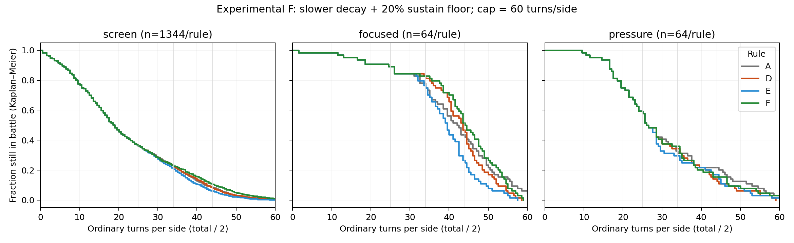

# Bổ sung phương án F: Tinh thần giảm chậm, hồi/Khiên có sàn 20%

Ngày 2026-10-22 UTC. Tiếp nối [kiểm chứng AI/Tinh thần A–E](2026-10-22-tinh-than-ai.md) và [đợt cải tổ kỹ năng](2026-10-22-ky-nang.md). **F chỉ là thử nghiệm; mặc định production vẫn A. Không merge, push hoặc deploy.**

F giữ hoạt động hồi/Khiên cuối trận tốt hơn A/D trong các nhóm đã đo, nhưng làm đuôi trận dài tăng so với D/E. Chưa có bằng chứng vòng hồi phục ở sàn 20% giữ tổng HP đứng yên trong những trace kiểm tra; vẫn có nhiều trận chưa kết thúc tại cap. Khuyến nghị tiếp tục chơi thử có đối chứng F/E, chưa chọn F làm mặc định.

## Định nghĩa và kiểm tra code

| Luật thực tế | Giảm từ lượt 25 riêng của phe | ATK/DEF do TT tại 0 | Hồi/Khiên mới tại 0 | TT về 0 |
|---|---:|---:|---:|---:|
| A, mặc định | 10/lượt | 70% | 0% | 34 |
| D | 5/lượt | 100% | 0% | 44 |
| E | 10/lượt | 100% | 20% | 34 |
| F, mới | 5/lượt | 100% | 20% | 44 |

Nhãn khớp định nghĩa task trước. F chỉ thêm `{decay:5, statFloor:1, healFloor:.2}` vào `SPIRIT_EXPERIMENTS`; battle, AI và giao diện dùng cùng các helper theo cấu hình, không có nhánh F riêng. “100%” là hệ số do TT: buff/debuff, xuyên giáp, quân lương và các hệ số khác vẫn hoạt động bình thường.

| Lượt riêng của phe | 24 | 25 | 30 | 35 | 40 | 44 trở đi |
|---|---:|---:|---:|---:|---:|---:|
| TT F | 100 | 95 | 70 | 45 | 20 | 0 |
| Hồi/Khiên mới F | 100% | 96% | 76% | 56% | 36% | 20% |

Đã kiểm tra cả hai phe đi trước, lượt thêm không giảm TT, lượt thường bị Đóng băng vẫn giảm, Khiên cũ giữ nguyên, Khiên đội theo từng người nhận, hồi trực tiếp/regen/hút máu và hồi dư Y sư chỉ nhân một lần. AI đọc hệ số F qua cơ chế chung, không sửa trọng số hay quy tắc chọn chiêu. UI thẻ tướng trước đây luôn tính theo A: đã truyền cấu hình đang chạy vào helper và tooltip; thông báo bắt đầu giảm cũng đọc tốc độ trong cấu hình. API production tiếp tục bỏ tùy chọn thử nghiệm từ request.

[SHA nguồn trước sửa](2026-10-22-spirit-f/reuse-source-verification.json) khớp báo cáo trước. Bỏ đúng phần thêm F khỏi rules thì SHA của cấu hình A–E khớp nguyên văn. [512 replay](2026-10-22-spirit-f/replay-equivalence.json) trùng tuyệt đối kết quả, counts, cơ hội kỹ năng, sát thương, lương, đội hình và seed. [Các file được bảo vệ](2026-10-22-spirit-f/protected-files.json) khớp baseline trước: bộ kỹ năng/chi phí, roster/chỉ số, tiến trình/phân điểm, campaign/preset, package và lockfile không đổi. Luật lương trong rules không đổi. HEAD gốc `ab357e3`; nguồn thực nghiệm gồm các thay đổi chưa commit từ hai task trước, vì vậy [SHA hiện tại](2026-10-22-spirit-f/source-sha256.json) mới là định danh tái lập.

## Ngân sách và điều kiện đối chứng

Pilot 6 trận F theo harness cũ, rồi 8 trận F Binh lính/Y sư đối đầu tấn công ở cấp 20; pilot thứ hai kết thúc trong tối đa 30 lượt/phe, không cap. Giữ ngân sách sàng lọc cũ và mở rộng có trọng tâm 64 trận hỗ trợ; không tăng toàn bộ số seed/cấu hình. Hai pilot 14 trận và 14 replay trace không cộng vào mẫu chính.

Có **2.614 trận chạy mới**, đối chiếu **1.648 case × 4 luật**. Đây là các quan sát ghép cặp, không phải 6.592 mẫu độc lập. 838/1.344 trận sàng lọc kết thúc trước lượt 25: dùng lại A cho D/E/F vì toàn bộ hành vi trước mốc đó đồng nhất. Chỉ 506 case còn lại chạy mới D/E/F. A sàng lọc và các đối chứng chiến dịch phù hợp đọc dữ liệu cũ; replay nhóm spirit/focused nhằm kiểm tra tương thích và bổ sung telemetry Khiên. [Manifest dùng lại](2026-10-22-spirit-f/reuse-manifest.json) phân biệt từng nguồn.

Sàng lọc giữ đủ 6 nghề × 7 hệ × 4 cấp 9/10/15/20 × 1 vs 1/3 vs 3 × 2 seed × 2 đổi bên. ĐBL luôn có trong đội focal; đủ 60 đồng đội tham gia. Bốn archetype tấn công/cân bằng/phòng thủ/phá tài nguyên giữ cách xoay của sampler đã sửa. Nhóm chung 128 case; phòng thủ 64 case dùng thêm seed 3119/4567/6079/7919. Nhóm pressure 64 case gồm ĐBL Binh lính/Y sư + hỗ trợ vs tấn công, ba nguồn Y sư vs tấn công và Y sư mirror, đủ 4 cấp,2 seed và 2 thứ tự. Các case cũ vượt 34/cap đều nằm trong 506 case sàng lọc được chạy F.

Phong Châu + Tam Đái dùng preset thực tế, hai đội hình đã có,3 seed và 2 đổi bên. Một nhánh không trang bị; một nhánh ba món trắng cùng hệ của phe người chơi như task trước. Trong từng case, mọi luật giữ nguyên code/AI/đội/cấp/đồ/phân điểm/seed/giới hạn. Không điều chỉnh trùm để bù.

Cap 120 lượt thường tổng, tối đa 60/phe; lượt thêm không đẩy nhanh TT hoặc cap. Trận hết cap chưa có thắng là censored, ghi riêng. Hòa tự nhiên bằng 0 trong tất cả nhóm. Không chuyển lượt thành phút chơi.

## Kết quả ghép cặp

Trung vị/P 90 dùng Kaplan–Meier, đơn vị tổng lượt thường/2. Cột từng phe focal/opponent nằm trong [summary.csv](2026-10-22-spirit-f/summary.csv). Tỉ lệ vượt mốc xét có phe vượt mốc; không gộp cap thành trận kết thúc thường.

| Nhóm | Luật | n | Thắng / thua | Cap | Trung vị / P 90 | >25 / >34 / >44 |
|---|---|---:|---:|---:|---:|---:|
| Sàng lọc nghề/hệ | A | 1344 | 755 / 577 | 12 | 19.0 / 42.5 | 36.2% / 22.4% / 8.6% |
| Sàng lọc nghề/hệ | D | 1344 | 755 / 582 | 7 | 19.0 / 42.5 | 36.2% / 22.2% / 8.0% |
| Sàng lọc nghề/hệ | E | 1344 | 752 / 590 | 2 | 19.0 / 41.0 | 36.2% / 20.8% / 6.0% |
| Sàng lọc nghề/hệ | F | 1344 | 738 / 590 | 16 | 19.0 / 44.5 | 36.2% / 22.8% / 10.6% |
| Nhóm chung A–F | A | 128 | 63 / 64 | 1 | 18.0 / 45.5 | 32.8% / 22.7% / 10.9% |
| Nhóm chung A–F | D | 128 | 67 / 60 | 1 | 18.0 / 45.0 | 32.8% / 24.2% / 11.7% |
| Nhóm chung A–F | E | 128 | 69 / 59 | 0 | 18.0 / 45.5 | 32.8% / 24.2% / 10.9% |
| Nhóm chung A–F | F | 128 | 60 / 66 | 2 | 18.0 / 49.0 | 32.8% / 25.0% / 17.2% |
| Phòng thủ thêm seed | A | 64 | 27 / 34 | 3 | 42.0 / 56.0 | 89.1% / 75.0% / 42.2% |
| Phòng thủ thêm seed | D | 64 | 26 / 38 | 0 | 43.5 / 52.5 | 89.1% / 81.2% / 45.3% |
| Phòng thủ thêm seed | E | 64 | 28 / 36 | 0 | 39.5 / 49.5 | 89.1% / 75.0% / 25.0% |
| Phòng thủ thêm seed | F | 64 | 27 / 37 | 0 | 44.0 / 55.0 | 89.1% / 82.8% / 50.0% |
| Hỗ trợ chịu áp lực | A | 64 | 40 / 22 | 2 | 26.0 / 53.0 | 57.8% / 31.2% / 21.9% |
| Hỗ trợ chịu áp lực | D | 64 | 42 / 22 | 0 | 26.0 / 47.0 | 57.8% / 34.4% / 12.5% |
| Hỗ trợ chịu áp lực | E | 64 | 38 / 25 | 1 | 26.0 / 46.0 | 57.8% / 29.7% / 17.2% |
| Hỗ trợ chịu áp lực | F | 64 | 38 / 25 | 1 | 26.0 / 47.0 | 57.8% / 35.9% / 15.6% |
| Chiến dịch không đồ | A | 24 | 11 / 13 | 0 | 24.5 / 42.0 | 50.0% / 25.0% / 8.3% |
| Chiến dịch không đồ | D | 24 | 14 / 10 | 0 | 24.5 / 37.0 | 50.0% / 29.2% / 0.0% |
| Chiến dịch không đồ | E | 24 | 12 / 12 | 0 | 24.5 / 39.5 | 50.0% / 33.3% / 0.0% |
| Chiến dịch không đồ | F | 24 | 12 / 12 | 0 | 24.5 / 43.0 | 50.0% / 29.2% / 8.3% |
| Chiến dịch trắng × 3 | A | 24 | 15 / 9 | 0 | 30.0 / 45.5 | 58.3% / 33.3% / 16.7% |
| Chiến dịch trắng × 3 | D | 24 | 16 / 8 | 0 | 28.5 / 38.5 | 58.3% / 41.7% / 0.0% |
| Chiến dịch trắng × 3 | E | 24 | 15 / 9 | 0 | 28.5 / 40.5 | 58.3% / 29.2% / 4.2% |
| Chiến dịch trắng × 3 | F | 24 | 16 / 8 | 0 | 28.5 / 40.0 | 58.3% / 41.7% / 4.2% |

Trong sàng lọc, F–D tăng P 90 từ 42,5 lên 44,5; >44 tăng 7,96%→10,57%; cap 7→16 (0,52%→1,19%). Thời lượng trung bình bị chặn tại cap tăng 0,44 lượt/phe, CI 95% theo seed [0,31;0,58]; cap tăng 0,67 điểm%, CI [0,15;1,32]. Có 79 case dài thêm ít nhất 5 lượt/phe và 60 đổi người thắng khi cả hai luật kết thúc.

F–E tăng P 90 41→44,5; >44 tăng 6,03%→10,57%; cap 2→16. Thời lượng bị chặn tăng 0,93 [0,73;1,13] lượt/phe;132 case dài thêm ít nhất 5. Trong phòng thủ mở rộng, F dài hơn E trung bình 4,42 [2,82;6,18] lượt/phe; P 90 55 so 49,5. Đây là tác động rõ hơn việc thêm sàn vào đường giảm 5/lượt.

F–A tăng P 90 42,5→44,5 và cap 12→16. Chênh cap+0,30 điểm% có CI [-0,30;0,98], chưa chắc chắn trong tập này; thời lượng bị chặn tăng 0,42 [0,23;0,63]. Ngược lại pressure F ngắn hơn A trung bình 0,75 lượt/phe và phòng thủ mở rộng F không cap trong khi A cap 3/64. Không có một hướng thay đổi chung cho mọi đội.

Bootstrap 2.000 lần theo **seed bàn thực tế**, giữ cả hai thứ tự cùng cụm; sàng lọc 150 cụm, spirit 32, focused 16, pressure 8, campaign 3. CI chỉ phản ánh tập preset/seed đã chọn, không chứng minh cân bằng tổng thể; không diễn giải CI chiến dịch 3 cụm như thử nghiệm đủ lực thống kê. Xem [toàn bộ so sánh](2026-10-22-spirit-f/paired-comparisons.json), [nhóm](2026-10-22-spirit-f/groups.csv) và [ô nghề/hệ](2026-10-22-spirit-f/screen-cells.csv), mỗi ô sàng lọc chỉ 4 trận.

F–D đo tác động **cả đường cong có sàn** `.2+.8×TT/100`, không chỉ thêm 20% khi đã tới 44: ngay lượt 25 F 96%, D 95%. F–E giữ cùng sàn và đo tốc độ giảm. F–A gồm cả khác biệt ATK/DEF, tốc độ và đường hồi/Khiên.

## Giá trị hỗ trợ, Khiên và quân lương

Nhóm phòng thủ 64 case, trung bình mỗi trận; sát thương là HP thực mất, hấp thụ ghi riêng:

| Luật | Sát thương HP | Hồi hữu hiệu | Khiên gia tăng | Khiên hấp thụ | Lương TB/đầu lượt | Mất HP hết lương |
|---|---:|---:|---:|---:|---:|---:|
| A | 6262,1 | 3572,1 | 1849,5 | 1368,6 | 73,0 | 12,4 |
| D | 6818,1 | 4242,8 | 2021,4 | 1486,2 | 71,8 | 16,0 |
| E | 6492,0 | 3872,7 | 1892,4 | 1397,8 | 72,1 | 9,7 |
| F | 7172,2 | 4600,8 | 2113,5 | 1561,7 | 71,0 | 26,5 |

F cấp 135.262 điểm Khiên gia tăng:99.950 thực sự hấp thụ,31.385 hết hạn/bị gỡ,3.927 còn cuối mẫu;0 còn trên người gục. Cộng đúng 135.262. Ngoài ra 36.964 điểm không cộng dồn do giữ Khiên mạnh hơn, chưa từng được cấp nên không tính là Khiên hữu ích hoặc bị thay thế. Y sư có Khiên hồi dư tạm thời nên mất vì hết hạn đáng kể; tăng lượng cấp không đồng nghĩa tăng giá trị tương ứng. Expiry/dispel dùng cùng event không có lý do, nên telemetry gộp hai loại, không đoán.

Sau mốc vòng 44 trong focused, tổng hồi hữu hiệu A/D=0, E=2.179, F=6.738; hấp thụ A=1.104, D=1.070, E=405, F=1.185. A/D vẫn hấp thụ từ Khiên cũ. F cũng có nhiều thời gian tiếp xúc muộn hơn (527 lượt thường tổng so D 368/E 199), vì vậy không đọc tổng hồi như hiệu quả mỗi lượt hoặc lợi ích thuần cho một nghề.

**Định nghĩa phase:** [phases.csv](2026-10-22-spirit-f/phases.csv) chia vòng chung `ceil(lượt tổng/2)` thành trước 25/25–33/34–43/44+. Nửa đầu vòng 44, phe kia có thể mới đi 43 lượt. Vì vậy toàn bộ sàng lọc D có 12 Khiên mới trong vòng 44+, không phải D còn sàn: người nhận chưa tới lượt 44 của họ. [trace-receiver-windows.csv](2026-10-22-spirit-f/trace-receiver-windows.csv) đối chiếu chính xác theo lượt riêng của người nhận. Tính toán trong engine luôn theo TT người nhận. 838 trận dùng lại không có phase mới, nhưng đã kết thúc trước 25 nên đóng góp 0 cho mọi phase muộn; chỉ phase trước 25 của sàng lọc là chưa đủ mẫu.

Trong focused F, Linh dược dùng 586/1.836 cơ hội hợp lệ đủ năng lượng và có giá trị theo scorer, hồi 128.338 HP hữu hiệu; A 446 lần/101.619 HP, D 532/117.746, E 458/104.451. Thủ thành F 177/1.026 cơ hội, cấp 32.078 và hấp thụ 31.079; Tường khiên 59/587, cấp 22.637/hấp thụ 22.326. Binh lính vẫn giữ lợi ích lương 3/lượt nếu còn sống thay vì 5; không sửa luật này. Các số này hỗ trợ kết luận vai trò hồi/bảo vệ còn hoạt động, không tự suy ra sức mạnh nghề từ thắng/thua.

Dưỡng sinh F 39/1.166 cơ hội. Trường `zeroImmediate=39` là **regen phát huy về sau**, không phải 39 lần vô dụng. Thạch Giáp có 83 cơ hội scorer dương nhưng 0 lần dùng trong focused F: thua cạnh tranh chiêu, không phải không mang theo hoặc không có cơ hội. Trong 506 case sàng lọc F đo mới, Thạch Giáp 50 lần cấp 16.011, hấp thụ 15.894,117 bị gỡ/hết hạn: không thấy cast không cấp Khiên trong nhóm này. Thủ thành/Tường khiên/Linh dược focused F cũng không có lần giá trị tức thì bằng 0.

Chưa lượng hóa phản thực HP tránh được nhờ DEF/buff/khiêu khích/giải hiệu ứng; không gọi chiêu đó “gần như vô dụng” chỉ vì không sinh HP/Khiên. Không có chỉ tiêu đếm chính xác mọi cast vô ích, nhưng dữ liệu đã tách phần sustain thực, phần mất và cạnh tranh lựa chọn. [skill-opportunities.csv](2026-10-22-spirit-f/skill-opportunities.csv), [skill-sustain-value.csv](2026-10-22-spirit-f/skill-sustain-value.csv) lưu mẫu số và giá trị; Mẫu cơ hội theo nghề sau từng mốc trong các trace được chọn nằm ở [late-role-opportunities-traces.csv](2026-10-22-spirit-f/late-role-opportunities-traces.csv), không đại diện toàn bộ sampler; cơ hội là lần AI được gọi chọn kỹ năng, gồm lượt thêm, không phải số lượt phe hay quota phải dùng.

## Trace: dài có tiến triển hay vòng hồi phục?

Chọn tất định; tiêu chí và ID đầy đủ trong [manifest](2026-10-22-spirit-f/trace-manifest.json).14 trace gồm F/D cho 6 lựa chọn và A/E thêm cho chênh lệch lớn nhất. Không cộng replay vào n chính.

| Tiêu chí | Case rút gọn | F / D lượt mỗi phe | Quan sát F |
|---|---|---:|---|
| Điển hình trong trận phòng thủ hoàn tất >34, gần trung vị của nhóm điều kiện này | Binh lính/Thổ lv 20,solo,1907,side 0 | 45,5 / 42,5 | Sau 44 mất ròng 870 HP, có 1 gục; tiến triển rõ |
| Phòng thủ dài nhất nhưng hoàn tất | Y sư mirror lv 9,4567,side 0 | 60 / 55 | Kết thúc đúng lượt 120, không censor;10 lượt cuối/phe mất ròng 695 HP,2 gục |
| F dài hơn D nhiều nhất | Binh lính/Lôi lv 15,solo,1907,side 0 | 49 / 34,5 | +14,5; F thua, D thắng; sau 44 mất ròng 1.052 HP |
| Đổi kết quả, dài nhất trong các flip F/D hoàn tất | Binh lính/Mộc lv 9,3 v 3,1907,side 1 | 59 / 55,5 | F thắng/D thua;10 lượt cuối mất ròng 1.177 HP,1 gục |
| Cap theo ID đầu tiên | Y sư mirror lv 10,4567,side 1 | cap 60 / 55 |10 lượt cuối mất ròng 1.089 HP,3 gục; vẫn chưa xong trước cap |
| Trong mọi F cap, ít mất HP tương đối nhất sau 44 | Quân sư/Mộc lv 9,3 v 3,701,side 1 | cap 60 / 49 | Sau 44 mất ròng 1.025/3.999 HP;10 lượt cuối mất 473,không gục |

Mẫu cap cuối được chọn có chủ đích để tìm tiến triển yếu nhất, không đại diện trung bình. F có 19 quan sát cap qua các nhóm, và ngay mẫu mất HP tương đối ít nhất vẫn giảm 25,6% tổng maxHP ban đầu trong vòng 44–60. Đây là bằng chứng chống giả thuyết “tất cả trận cap do hồi/Khiên ở sàn duy trì HP ổn định”. Tuy vậy nó có thể tạo đoạn cuối chậm: mẫu đó không ai gục sau 44, và vẫn chưa biết kết cục nếu đi tiếp. Không tăng cap hoặc suy diễn rằng mọi trận sẽ tự kết thúc. [floor-exposure.csv](2026-10-22-spirit-f/floor-exposure.csv) và [các cửa sổ trace](2026-10-22-spirit-f/trace-windows.csv) lưu damage,heal,netHP,absorption,KO và kỹ năng.

## Chiến dịch, trình duyệt và kiểm tra

F không đồ: Phong Châu 7 thắng/5 thua, Tam Đái 5/7; cả hai n 12, không cap. F trắng× 3: Phong Châu 10/2, Tam Đái 6/6, không cap. Mẫu nhỏ, khác biệt tổng A/D/E/F trong bảng trên chưa biện minh sửa boss/preset hay luật lương.

Playwright dùng Chromium thật trên 1440 × 1000 và 390 × 844. Fixture browser gọi engine thật, chặn route chỉ trong context test, không thêm endpoint ứng dụng. F hiển thị đúng 100/96/76/56/36/20/20% tại 24/25/30/35/40/44/50; ATK/DEF do TT luôn 100%. Hồi mục tiêu khác TT khớp engine; ở lượt 50 TT 0, Linh dược thực sự hồi 69 HP. Đã thao tác chọn/hủy mục tiêu, kỹ năng vùng, kiểm tra không tràn ngang và không có pageerror. [Log](2026-10-22-spirit-f/browser.log), [desktop](2026-10-22-spirit-f/desktop-late-floor.png), [mobile](2026-10-22-spirit-f/mobile-late-floor.png).

Đây là kiểm chứng thao tác, hiển thị và giá trị số bằng trình duyệt, **chưa phải đánh giá cảm giác của người chơi**. Chưa có người chơi tự quyết định đổi giữa đánh/hồi/phòng thủ cuối trận.

Toàn bộ 333 test/83 suite pass,0 fail/skip; test audit 17/17; lint,typecheck,build production pass. Build không có DATABASE_URL nên script bỏ migration theo thiết kế; không tuyên bố kiểm chứng DB production. Các phép đối soát phase/tổng và bảo toàn Khiên đều pass trên mọi record telemetry mới. [Log kiểm tra](2026-10-22-spirit-f/tests-final.log), [hướng tái lập và giới hạn telemetry](2026-10-22-spirit-f/README.md).

## Quyết định đề xuất

1. **F có giữ hỗ trợ tốt hơn A/D?** Có đối với hoạt động hồi/Khiên đo được: có hồi sau 44, lượng hấp thụ thực tăng trong focused, các kỹ năng nghề tiếp tục sinh giá trị. Chưa đủ kết luận mọi đội Y sư/Binh lính mạnh hơn hoặc trải nghiệm hay hơn; thời gian sống dài hơn cũng làm tổng đóng góp tăng.
2. **Sàn 20% có gây bế tắc/đuôi dài?** F tăng cap và đuôi >44 so D/E trong sàng lọc. Chưa thấy vòng hồi giữ tổng HP đứng yên trong các trace đã soi, kể cả cap ít tiến triển nhất; rủi ro đuôi dài vẫn thực và không thể bỏ qua vì trận có tiến triển.
3. **Lợi ích so E?** Giai đoạn 25–43 giảm nhẹ hơn, duy trì thêm cơ hội và lượng hỗ trợ; đổi lại focused trung bình dài hơn khoảng 4,42 lượt/phe. Chưa có lợi thế thắng hoặc giảm cap nhất quán để gọi F vượt E.
4. **Chọn mặc định?** Tiếp tục thử F với E làm đối chứng nhanh hơn; chưa chọn F làm production, chưa cần loại bỏ. Không đổi hệ số kỹ năng/quân lương/chỉ số để cứu phương án.
5. **Người chơi cần quyết định:** khả năng dùng hỗ trợ muộn có đáng thêm đuôi trận không; đoạn không ai gục nhưng HP vẫn giảm có gây mệt không; hồi nhỏ ở sàn 20% có tạo lựa chọn đáng cân nhắc hay chỉ khiến đánh giá AI/player lệch nhau; và mức cap chấp nhận được. Nên chơi các trace điển hình, chênh +14,5 và cap yếu tiến triển theo cả F/E trước khi chọn luật mặc định.
