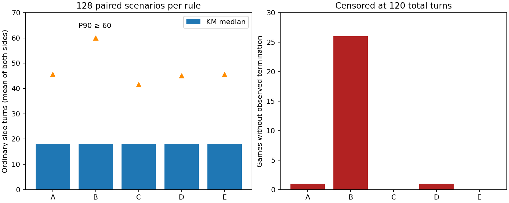

# Kiểm chứng AI và Tinh thần sau cải tổ kỹ năng

Ngày 22/10/2026. Tiếp nối [báo cáo cải tổ](2026-10-22-ky-nang.md). Giữ nguyên khung 3 nghề + 2 hệ + 1 tuyệt chiêu, mọi hệ số/giá/mốc mở và luật quân lương. Luật Tinh thần mặc định vẫn A; các nhánh B–E chỉ truyền nội bộ trong harness.

## Baseline và sửa bug

Checkout `work`, HEAD `ab357e34bfdd92c6fcf2068df6676ccb0f15c2de` có toàn bộ thay đổi chưa commit của đợt cải tổ trước; không reset hoặc ghi đè chúng. Snapshot trước sửa: `/workspace/audit-baseline/current.tar`, patch `/workspace/audit-baseline/working.patch`; SHA-256 ở [manifest](2026-10-22-spirit/baseline-sha256.txt). AI cũ được đóng băng trong `scripts/fixtures/2026-10-22-ai-before.ts`; import/exports chỉ đổi để chạy harness. Không coi HEAD đơn lẻ là baseline của bản cải tổ chưa commit.

Bug Y sư tái hiện trước sửa: HP 950/1000, TT50, ghép 3 tim, lượng hồi thô135 → lượng hồi hiệu dụng68 → hồi dư18. Code cũ cho43 Khiên; test thất bại `43 !== 18`. Đã sửa tính hồi hữu hiệu trước khi lấy dư và không nhân TT lần hai khi chuyển dư thành Khiên. Khi HP còn thiếu nhiều hơn lượng hồi hữu hiệu, không được tạo Khiên từ phần hồi thô bị triệt tiêu. Ở TT0 không có hồi hoặc Khiên mới. Đây là sửa bug, không đổi hệ số thiết kế.

ATK/DEF dùng hệ số buff/debuff rồi nhân TT, sau đó mới xuyên DEF trong công thức sát thương. Luật mặc định: TT100 đầu trận, từ lượt25 phe giảm10/lượt, lượt34 bằng0; mốc24/25/26/33/34/35 được kiểm tra cả hai phe đi trước, cả1vs1/3vs3. Lượt thêm không tăng bộ đếm; Đóng băng vẫn chịu lượt thường; người gục không giảm TT. Hồi trực tiếp, tim, Hồi phục và hút máu chịu TT người nhận; Khiên mới chịu TT, Khiên đang tồn tại không tự co lại. Làm mới giữ số lớn hơn và thời hạn dài hơn. Thiêu đốt lưu theo ATK gốc lúc tạo; Phản đòn dựa trên đòn nhận; mất máu hết lương theo maxHP. Ba nguồn gián tiếp không nhân TT lần nữa, nhưng đầu vào sát thương trực tiếp có thể đã chịu TT. Các luật đó không đổi.

Đã sửa thêm lỗi phép đo: cap không tính lượt vừa khởi đầu ngoài cap; snapshot lương cuối lấy từ event trong giới hạn, không lấy upkeep của lượt tiếp. Tái chạy đúng66 hàng censored bị ảnh hưởng; kiểm tra winner/decision/counter/source giống hệt trước sửa, chỉ finalFood snapshot và runtime đổi. Không cộng những lượt tái chạy này vào n.

## Sửa AI và phạm vi heuristic

- Sửa tính giá trị sát thương/ô kiếm/hồi/Khiên theo chỉ số hiệu dụng và TT, buff/debuff, sĩ khí, xuyên giáp, bị động thủ lĩnh. Dùng cùng helper hiệu dụng với engine. Sửa thứ tự làm tròn hồi/hút máu.
- Trừ phần Khiên mới không vượt Khiên đang có và Hồi phục đang tồn tại. Bỏ giá trị hồi/Khiên mới ở TT0. Khiên cũ vẫn có giá trị hấp thụ và Xua tan.
- Ly gián dự báo luân phiên trong đúng thời hạn: năng lượng/kỹ năng mục tiêu và số lần mục tiêu kịp hành động. Không coi người chưa tới lượt trước hết Câm lặng là một mục tiêu có cùng giá trị.
- Phản kích dùng lượng sát thương dự kiến, phần hướng đòn qua Khiêu khích, đồng đội còn sống và tình huống1vs1. Đoạt mệnh dùng HP trước đòn; thêm cùng thưởng kết liễu mà bộ chấm nước đổi ô đã có. Đây là cải tiến heuristic ngoài sửa công thức, được đo chung trong nhánh AI mới, không giả định là một bug của engine.
- Giữ ngưỡng tiết kiệm năng lượng/giá lượt dùng, không quota dùng chiêu, không tăng sức mạnh chiêu. Không mở rộng sang AI phối hợp nhiều lượt. Cascade bàn cờ giữ thu hoạch giảm, không đọc boardRng; test ngang bằng thông tin vẫn chạy.

## Phương pháp và ngân sách

Pilot engine cũ:4 trận khoảng1,08s. Pilot có đo chi tiết:6 trận khoảng2,93s (khác đội/cấp, không dùng để kết luận tăng/giảm hiệu năng). Chọn 5 tiến trình mô phỏng tối đa trên5 CPU; log elapsedMs từng trận ở dữ liệu gốc. Không quy lượt ra phút theo tốc độ AI.

Sàng lọc AI:42 tổ hợp ĐBL ×4 cấp9/10/15/20 ×2 chế độ ×2 seed cơ sở701/1907 ×2 hướng =1.344 trận/AI. ĐBL luôn có mặt ở focalSide. Mỗi cặp cùng seed và đội: phe có ĐBL ở bên0/đi trước, rồi đổi sang bên1/đi sau. 3vs3 phân tầng tấn công/cân bằng/phòng thủ/phá tài nguyên, xoay nghề và phần tử trong toàn60 nhân vật kèm; test xác nhận đủ61 ID gồm ĐBL. Không dùng cặp đầu roster. 1vs1 ghi đối thủ cụ thể trong raw participants. Mỗi ô nhỏ chỉ4 trận, là sàng lọc không phải cân bằng đủ lực thống kê.

Tất cả generic dùng không trang bị và `autoProgress(level,null)` như nhau giữa phương án; phân đều điểm vào ô thấp nhất theo thứ tự1/2/3/5/4/6, không điểm thưởng hay ưu tiên riêng cho chiêu hiếm. Cùng seed không bảo đảm cùng diễn biến sau khi quyết định AI khác.

Nhánh A so AI before/after giữ **cùng engine đã sửa bug Y sư, cùng luật A và kỹ năng**. Vì vậy tách được tác động AI; không quy chênh lệch đó cho chuyển khung kỹ năng hay sửa bug. Tác động riêng của sửa bug được chứng minh bằng test định lượng43→18, chưa chạy một ma trận nhân tố engine-cũ/engine-mới. AI cũ vẫn chạy với helper cascade tương thích, nhưng scorer/selector là bản đóng băng.

Tinh thần dùng AI mới cố định:4 nhóm đội ×4 cấp ×2 chế độ ×2 seed ×2 hướng =128 trận/phương án. Có phòng thủ đấu phòng thủ. A=mặc định; B=không giảm; C=chỉ giảm hồi/Khiên10/lượt; D=giảm hồi/Khiên5/lượt, về0 lượt44; E=hồi/Khiên giữ sàn20%. B–E có ATK/DEF100%. Sau pilot, chỉ mở rộng A/C/E trên phòng thủ với4 seed mới3119/4567/6079/7919,64 trận/phương án. Không mở rộng B/D khi chưa có lợi thế rõ.

Giới hạn120 lượt thường tổng hai phe, tương đương60 lượt/phe khi chưa kết thúc. Lượt thêm là hành động bổ sung trong lượt, không tăng bộ đếm này. Censored không gọi là thua/hòa hoặc thời lượng kết thúc. Chưa có luật hòa tự nhiên ở engine; cột hòa tự nhiên bằng0. KM median/P90 xử lý right censoring, P90 không nhận diện thì ghi≥60. Nền tảng duration là (lượt thường đã bắt đầu của phe0+phe1)/2, nên có bước0,5.

Độ bất định: bootstrap2.000 lần, seed20261022, gom cùng board seed (cả hai hướng và mọi cấu hình trùng seed) vào một cluster và ghép các biến thể theo caseId. CI95% dưới đây là CI mô hình có điều kiện trên các kịch bản đã chọn; cùng roster/lớp đội/cấp tạo phụ thuộc rộng hơn, nên không suy rộng thành CI cân bằng toàn game. Không coi hai hướng hay các biến thể trên cùng seed là quan sát độc lập. Chỉ số thắng là **thắng quan sát được trong cap/n**, không giả định trận censored thua cuối cùng.

Mỗi lớp đội/cấp/chế độ có n, thắng/thua/censor, duration KM, lượng hỗ trợ/lương, cơ hội kỹ năng và runtime riêng tại [spirit-groups.csv](2026-10-22-spirit/spirit-groups.csv). seedWinMin/Max là khoảng quan sát giữa các seed (không phải CI95%); nhóm nhỏ4 trận không đủ để ước lượng cân bằng tin cậy.

## Kết quả chính

| Tập | n | Thắng / thua / censored | KM trung vị / P90 lượt | >25 / >34 / >44 |
|---|---:|---|---|---|
| screen-before | 1344 | 707 / 616 / 21 | 19.0 / 45.5 | 36.3% / 24.3% / 11.2% |
| screen-after | 1344 | 755 / 577 / 12 | 19.0 / 42.5 | 36.2% / 22.4% / 8.6% |
| spirit-A | 128 | 63 / 64 / 1 | 18.0 / 45.5 | 32.8% / 22.7% / 10.9% |
| spirit-B | 128 | 53 / 49 / 26 | 18.0 / ≥60 / chưa xác định | 32.8% / 25.0% / 22.7% |
| spirit-C | 128 | 69 / 59 / 0 | 18.0 / 41.5 | 32.0% / 20.3% / 7.0% |
| spirit-D | 128 | 67 / 60 / 1 | 18.0 / 45.0 | 32.8% / 24.2% / 11.7% |
| spirit-E | 128 | 69 / 59 / 0 | 18.0 / 45.5 | 32.8% / 24.2% / 10.9% |
| focused-A | 64 | 27 / 34 / 3 | 42.0 / 56.0 | 89.1% / 75.0% / 42.2% |
| focused-C | 64 | 30 / 34 / 0 | 38.5 / 49.5 | 89.1% / 68.8% / 25.0% |
| focused-E | 64 | 28 / 36 / 0 | 39.5 / 49.5 | 89.1% / 75.0% / 25.0% |
| campaign-before-A | 24 | 9 / 15 / 0 | 22.5 / 44.0 | 37.5% / 29.2% / 8.3% |
| campaign-after-A | 24 | 11 / 13 / 0 | 24.5 / 42.0 | 50.0% / 25.0% / 8.3% |
| campaign-after-B | 24 | 12 / 10 / 2 | 24.5 / 49.0 | 50.0% / 33.3% / 20.8% |
| campaign-after-C | 24 | 12 / 12 / 0 | 24.5 / 37.0 | 50.0% / 29.2% / 0.0% |
| campaign-after-D | 24 | 14 / 10 / 0 | 24.5 / 37.0 | 50.0% / 29.2% / 0.0% |
| campaign-after-E | 24 | 12 / 12 / 0 | 24.5 / 39.5 | 50.0% / 33.3% / 0.0% |
| campaign-gear-before-A | 24 | 12 / 12 / 0 | 22.5 / 41.0 | 41.7% / 29.2% / 8.3% |
| campaign-gear-after-A | 24 | 15 / 9 / 0 | 30.0 / 45.5 | 58.3% / 33.3% / 16.7% |
| campaign-gear-after-C | 24 | 15 / 9 / 0 | 28.5 / 37.0 | 58.3% / 25.0% / 0.0% |
| campaign-gear-after-E | 24 | 15 / 9 / 0 | 28.5 / 40.5 | 58.3% / 29.2% / 4.2% |

| So sánh ghép cặp | Δ thắng trong cap | CI95% cluster bootstrap | Cluster seed | Đổi kết quả đã kết thúc | Đổi trạng thái censor |
|---|---|---|---:|---:|---:|
| AI before→after | 3.6% | [1.3%; 6.0%] | 150 | 279 | 25 |
| A→B | -7.8% | [-15.6%; -1.6%] | 32 | 3 | 25 |
| A→C | 4.7% | [0.0%; 10.2%] | 32 | 11 | 1 |
| C→D | -1.6% | [-4.7%; 1.6%] | 32 | 5 | 1 |
| C→E | 0.0% | [-3.9%; 3.9%] | 32 | 8 | 0 |
| focused A→C | 4.7% | [-9.4%; 17.2%] | 16 | 11 | 3 |
| focused C→E | -3.1% | [-15.6%; 9.4%] | 16 | 12 | 0 |

## Damage, hỗ trợ và lương

Giá trị trung bình/trận, cộng cả hai phe. Giảm tiềm năng hồi/Khiên do TT tách khỏi hồi dư và không cộng dồn; không đồng nhất giảm tiềm năng với HP thực tế bị mất. Hồi dư gồm phần có thể chuyển thành Khiên, cột converted trong CSV ghi riêng; không cộng hai cột đó thành hai tổn thất. Khiên nhận là phần tăng lượng Khiên, thời hạn được làm mới không đếm thành Khiên mới.

| Tập | HP mất | Hồi hữu hiệu | Khiên nhận / hấp thụ | Hồi bị TT giảm / hồi dư | Khiên bị TT giảm / không cộng dồn | Lương cuối | Lượt Đói / hết lương (hai phe) | HP mất vì hết lương | Chiêu/trận |
|---|---:|---:|---|---|---|---:|---|---:|---:|
| spirit-A | 4218 | 1803 | 539 / 400 | 425 / 637 | 43 / 136 | 62.8 | 4.3 / 0.6 | 25 | 12.8 |
| spirit-B | 4643 | 2623 | 1026 / 737 | 0 / 1117 | 0 / 251 | 62.0 | 4.8 / 0.7 | 27 | 15.9 |
| spirit-C | 4215 | 1790 | 533 / 394 | 310 / 634 | 33 / 136 | 63.1 | 4.1 / 0.6 | 23 | 12.2 |
| spirit-D | 4422 | 1965 | 580 / 432 | 395 / 694 | 37 / 151 | 63.9 | 4.5 / 0.6 | 22 | 13.3 |
| spirit-E | 4346 | 1886 | 551 / 408 | 383 / 652 | 31 / 137 | 63.2 | 4.4 / 0.6 | 24 | 12.7 |
| focused-A | 6262 | 3572 | 1849 / 1369 | 1556 / 2011 | 118 / 511 | 84.0 | 3.4 / 0.3 | 12 | 29.1 |
| focused-C | 6249 | 3572 | 1827 / 1354 | 1176 / 1985 | 105 / 509 | 84.8 | 2.6 / 0.2 | 10 | 26.8 |
| focused-E | 6492 | 3873 | 1892 / 1398 | 1324 / 2056 | 106 / 531 | 84.1 | 2.8 / 0.2 | 10 | 27.8 |
| campaign-before-A | 4449 | 1395 | 778 / 701 | 438 / 233 | 310 / 276 | 71.7 | 4.9 / 0.1 | 2 | 14.5 |
| campaign-after-A | 4479 | 1470 | 736 / 642 | 188 / 285 | 100 / 294 | 73.0 | 4.5 / 0.0 | 1 | 13.2 |
| campaign-after-B | 4756 | 1874 | 1089 / 906 | 0 / 495 | 0 / 531 | 75.1 | 5.1 / 0.0 | 0 | 16.1 |
| campaign-after-C | 4499 | 1485 | 739 / 640 | 154 / 287 | 76 / 293 | 74.5 | 4.4 / 0.0 | 1 | 13.0 |
| campaign-after-D | 4494 | 1587 | 800 / 679 | 142 / 328 | 65 / 326 | 73.8 | 4.6 / 0.0 | 0 | 13.4 |
| campaign-after-E | 4580 | 1532 | 764 / 666 | 185 / 305 | 83 / 309 | 74.3 | 4.5 / 0.0 | 0 | 13.5 |
| campaign-gear-before-A | 4751 | 1486 | 755 / 669 | 419 / 267 | 229 / 270 | 71.7 | 6.4 / 0.4 | 14 | 14.5 |
| campaign-gear-after-A | 4666 | 1504 | 790 / 694 | 302 / 284 | 128 / 387 | 70.0 | 6.4 / 0.0 | 1 | 13.9 |
| campaign-gear-after-C | 4616 | 1515 | 786 / 680 | 186 / 286 | 105 / 390 | 66.9 | 5.8 / 0.1 | 2 | 13.1 |
| campaign-gear-after-E | 4645 | 1558 | 799 / 688 | 188 / 290 | 107 / 402 | 64.3 | 6.1 / 0.1 | 2 | 13.4 |

## Chiêu hiếm: cơ hội và lựa chọn

Carried=lượt thường nhân vật còn sống mang chiêu đã mở. Actions=gồm lượt thêm. Legal=được ra tay, chưa dùng chiêu và không Câm lặng; affordable=legal đủ năng lượng. Suitable=đủ điều kiện đó và tình huống có giá trị (Đoạt mệnh:HP≤35%; Ly gián:địch có chiêu đủ năng lượng, chưa đóng băng/Câm lặng; các chiêu khác scorer>0). Vì đo tình huống kết liễu bằng ngưỡng, uses của Đoạt mệnh có thể vượt suitable nếu AI dùng nó khi còn >35% nhưng đòn vẫn hiệu quả. Energy là năng lượng actor đã chi trước cơ hội phù hợp đầu tiên trong từng trận, lấy trung bình những trận có cơ hội, không phải tổng mọi actor.

| AI | Chiêu | Carried | Actions | Legal | Affordable | Suitable | Uses | Score TB/max | Energy trước cơ hội đầu |
|---|---|---:|---:|---:|---:|---:|---:|---|---:|
| screen-before | element_hauThoTichLuong | 17672 | 13678 | 13633 | 7071 | 7071 | 1555 | 100.2/129.0 | 0.0 |
| screen-before | element_kimYNgungThan | 4103 | 2906 | 2902 | 1052 | 1052 | 51 | 116.7/155.3 | 4.3 |
| screen-before | element_linhMocHoiSinh | 4217 | 3029 | 3027 | 1381 | 1381 | 245 | 165.1/312.6 | 0.0 |
| screen-before | element_loiTruGiangThe | 14037 | 10561 | 10542 | 3551 | 3551 | 748 | 170.6/1131.4 | 5.7 |
| screen-before | element_lucDiepPhong | 16607 | 12050 | 12010 | 4922 | 4922 | 1 | 64.7/125.9 | 8.3 |
| screen-before | element_luyenKimThanhKiem | 14924 | 10989 | 10960 | 6581 | 6581 | 0 | 40.4/51.6 | 0.0 |
| screen-before | element_noHoaThieuThan | 4529 | 3008 | 2996 | 1392 | 1326 | 87 | 156.8/195.0 | 0.7 |
| screen-before | element_phongHoaThieuDoanh | 15882 | 10793 | 10761 | 3673 | 3673 | 1398 | 220.4/1291.8 | 4.2 |
| screen-before | element_phongQuyenTanVan | 13644 | 10203 | 10184 | 3515 | 3515 | 804 | 199.4/1208.5 | 5.1 |
| screen-before | element_thachGiap | 4534 | 3585 | 3564 | 1639 | 985 | 64 | 105.3/271.3 | 2.8 |
| screen-before | element_thanhLuuTayTran | 3987 | 2954 | 2946 | 1527 | 1180 | 93 | 95.6/274.4 | 6.9 |
| screen-before | element_thanhPhongTuKhi | 3590 | 2561 | 2555 | 1328 | 1328 | 23 | 81.2/152.9 | 0.0 |
| screen-before | element_thuyNguyetTuLinh | 17007 | 12612 | 12583 | 7788 | 7788 | 0 | 50.8/64.5 | 0.0 |
| screen-before | element_tinhDienHoThan | 3445 | 2713 | 2703 | 1293 | 1273 | 37 | 93.5/129.0 | 0.0 |
| screen-before | role_catQuanLuong | 7981 | 5712 | 5700 | 1388 | 1379 | 17 | 120.9/187.2 | 11.8 |
| screen-before | role_doatMenh | 8358 | 5902 | 5888 | 931 | 167 | 3 | 229.0/445.2 | 70.7 |
| screen-before | role_duongSinh | 25344 | 18679 | 18627 | 4941 | 3383 | 355 | 141.1/502.6 | 21.0 |
| screen-before | role_hieuLenh | 18664 | 13657 | 13625 | 3645 | 3570 | 902 | 197.7/438.8 | 5.1 |
| screen-before | role_linhDuoc | 25344 | 18679 | 18627 | 8458 | 6404 | 3351 | 176.0/497.7 | 3.8 |
| screen-before | role_lyGian | 15715 | 11544 | 11530 | 3636 | 2219 | 0 | 67.5/179.4 | 19.8 |
| screen-before | role_muaChuoc | 15715 | 11544 | 11530 | 5978 | 5010 | 756 | 87.3/156.0 | 4.3 |
| screen-before | role_nghiBinh | 18664 | 13657 | 13625 | 6403 | 4644 | 640 | 108.3/181.1 | 1.5 |
| screen-before | role_nguHanhAn | 8489 | 6508 | 6483 | 2891 | 2891 | 62 | 139.4/198.9 | 0.4 |
| screen-before | role_phaKe | 9403 | 6825 | 6802 | 1349 | 409 | 54 | 56.0/1055.4 | 48.3 |
| screen-before | role_phaTran | 16037 | 11142 | 11125 | 2538 | 2538 | 570 | 236.1/341.7 | 14.2 |
| screen-before | role_phanKich | 13109 | 9790 | 9749 | 1975 | 1974 | 39 | 96.0/150.2 | 32.1 |
| screen-before | role_phepLan | 8489 | 6508 | 6483 | 3488 | 3488 | 425 | 145.5/305.3 | 0.0 |
| screen-before | role_teDo | 13006 | 9298 | 9255 | 1654 | 1199 | 69 | 189.2/686.4 | 34.3 |
| screen-before | role_thienDiaCong | 4661 | 3584 | 3575 | 1022 | 1022 | 650 | 427.8/1540.5 | 2.6 |
| screen-before | role_thuThanh | 25524 | 19356 | 19283 | 8998 | 5958 | 2299 | 123.1/293.9 | 0.4 |
| screen-before | role_tramKich | 16037 | 11142 | 11125 | 4721 | 4721 | 1002 | 182.2/259.7 | 0.0 |
| screen-before | role_tuongKhien | 25524 | 19356 | 19283 | 5355 | 3169 | 384 | 114.8/307.7 | 34.8 |
| screen-after | element_hauThoTichLuong | 16568 | 13296 | 13107 | 7002 | 7002 | 1721 | 100.1/129.0 | 0.0 |
| screen-after | element_kimYNgungThan | 3817 | 2819 | 2778 | 1118 | 1118 | 68 | 143.5/1028.0 | 4.0 |
| screen-after | element_linhMocHoiSinh | 4102 | 3006 | 2989 | 1485 | 1485 | 176 | 137.5/312.9 | 0.0 |
| screen-after | element_loiTruGiangThe | 13457 | 10325 | 10186 | 3742 | 3742 | 742 | 157.7/1102.1 | 6.9 |
| screen-after | element_lucDiepPhong | 15871 | 11563 | 11450 | 5129 | 5129 | 1 | 60.7/121.9 | 6.8 |
| screen-after | element_luyenKimThanhKiem | 14680 | 10923 | 10741 | 6606 | 6606 | 0 | 40.4/51.6 | 0.0 |
| screen-after | element_noHoaThieuThan | 4326 | 2967 | 2926 | 1472 | 1469 | 51 | 150.8/195.0 | 0.0 |
| screen-after | element_phongHoaThieuDoanh | 15343 | 10637 | 10476 | 3820 | 3820 | 1321 | 210.5/1281.8 | 4.5 |
| screen-after | element_phongQuyenTanVan | 12920 | 9692 | 9585 | 3545 | 3545 | 827 | 189.3/1219.1 | 5.6 |
| screen-after | element_thachGiap | 4197 | 3448 | 3383 | 1645 | 1175 | 65 | 100.7/271.2 | 0.8 |
| screen-after | element_thanhLuuTayTran | 3570 | 2752 | 2717 | 1399 | 888 | 60 | 79.3/274.0 | 7.3 |
| screen-after | element_thanhPhongTuKhi | 3377 | 2471 | 2455 | 1313 | 1313 | 14 | 80.0/152.9 | 0.0 |
| screen-after | element_thuyNguyetTuLinh | 15677 | 11980 | 11760 | 7361 | 7361 | 0 | 50.8/64.5 | 0.0 |
| screen-after | element_tinhDienHoThan | 3360 | 2715 | 2670 | 1313 | 1313 | 130 | 97.3/129.0 | 0.0 |
| screen-after | role_catQuanLuong | 7124 | 5234 | 5178 | 1140 | 1140 | 14 | 120.7/187.2 | 10.6 |
| screen-after | role_doatMenh | 7720 | 5516 | 5448 | 833 | 114 | 33 | 353.1/1340.0 | 63.5 |
| screen-after | role_duongSinh | 23827 | 17802 | 17602 | 5875 | 2881 | 223 | 103.0/504.0 | 22.6 |
| screen-after | role_hieuLenh | 18642 | 14133 | 13857 | 4098 | 4091 | 832 | 185.5/438.8 | 5.2 |
| screen-after | role_linhDuoc | 23827 | 17802 | 17602 | 9145 | 5321 | 2232 | 122.8/498.0 | 3.8 |
| screen-after | role_lyGian | 14519 | 10797 | 10639 | 3104 | 1828 | 461 | 125.9/413.4 | 16.4 |
| screen-after | role_muaChuoc | 14519 | 10797 | 10639 | 5370 | 4675 | 558 | 91.7/156.0 | 4.6 |
| screen-after | role_nghiBinh | 18642 | 14133 | 13857 | 6972 | 6929 | 681 | 115.1/240.0 | 0.0 |
| screen-after | role_nguHanhAn | 8115 | 6350 | 6257 | 2911 | 2911 | 58 | 180.3/1061.8 | 0.4 |
| screen-after | role_phaKe | 9458 | 7234 | 7130 | 1529 | 513 | 51 | 58.4/1098.0 | 52.0 |
| screen-after | role_phaTran | 14959 | 10513 | 10386 | 2293 | 2293 | 496 | 336.2/1453.0 | 14.6 |
| screen-after | role_phanKich | 12568 | 9570 | 9428 | 2095 | 2093 | 242 | 152.4/401.2 | 28.3 |
| screen-after | role_phepLan | 8115 | 6350 | 6257 | 3440 | 3440 | 469 | 174.8/1611.0 | 0.0 |
| screen-after | role_teDo | 12187 | 8821 | 8722 | 2181 | 1139 | 29 | 136.1/622.0 | 33.0 |
| screen-after | role_thienDiaCong | 4339 | 3428 | 3380 | 999 | 999 | 570 | 464.6/2581.1 | 2.6 |
| screen-after | role_thuThanh | 24454 | 18821 | 18564 | 9375 | 6696 | 1586 | 107.1/294.0 | 0.0 |
| screen-after | role_tramKich | 14959 | 10513 | 10386 | 4355 | 4355 | 1184 | 258.7/1167.0 | 0.0 |
| screen-after | role_tuongKhien | 24454 | 18821 | 18564 | 5742 | 3080 | 183 | 92.1/307.8 | 25.5 |

Phản kích đã được dùng39 lần trong baseline rộng, dù báo cáo cũ mẫu nhỏ ghi0: riêng số0 trước đó không chứng minh một bug. Tách cải thiện phép đo khỏi cải thiện AI; Ly gián0→461, Phản kích39→242, Đoạt mệnh3→33 là số liệu cùng sampler trước/sau mới. Lý do bỏ qua từng kỹ năng cạnh tranh, tổng score và thời điểm năng lượng được lưu đầy đủ trong [skill-opportunities.csv](2026-10-22-spirit/skill-opportunities.csv) và raw JSONL. `saving`=để dành cho option tốt hơn theo ngưỡng80%; `dominated:<id>`=đủ điều kiện nhưng option khác thắng điểm; `energy`, `noValue`, `belowThreshold`, `silenced`, `slotUsed` được tách riêng. Tổng reason=chosen được đối chiếu với event skill thực thi cho mọi trận: không có request kỹ năng bị AI chọn nhưng engine không thực thi.

## Chiến dịch

Phong Châu và đối chứng Tam Đái, đúng cấp gợi ý, food và tỉ lệ ô/preset/độ khó của màn. Đội default là tướng khởi đầu; đội heroes chỉ gồm tướng gia nhập ở màn trước, không dùng sứ quân chưa đánh bại. Bộ chính không trang bị để kiểm soát biến; thêm đối chứng white3: mỗi người chơi có3 món Trắng đồng hệ (vũ khí đúng nghề, đỉnh mão, y phục), đối thủ giữ preset trần. Đây là kịch bản đầu tư nhẹ có thể farm từ loot ở tiến trình đó, không giả định một phân bố đồ rơi đại diện mọi người chơi. Không đủ6 món cùng bộ để kích thưởng bộ; mọi cộng hưởng khác do engine tự tính. Điểm tự phân cùng chính sách. Có96 trận trang bị bổ sung cho before-A/after-A/C/E; tổng3.760 trận phân tích, không cộng pilot/trace/tái chạy kỹ thuật. Cấp/ATK/DEF/skillLevels cụ thể ở participants.3 seed, đổi bên;6 trận mỗi màn/đội/variant. Chưa tách đủ yếu tố tương tác nghề/hệ khỏi AI và TT; preset đối thủ giữ nguyên, không chỉnh trùm để bù.

| Variant | Màn | Đội | n | Thắng / thua / cap | KM median / P90 | Khoảng thắng giữa3 seed |
|---|---|---|---:|---|---|---|
| campaign-before-A | phongChau | haVan+maiThanh | 6 | 2/4/0 | 13.0/25.0 | 0.0%–50.0% |
| campaign-before-A | phongChau | trinhTu+leHoan | 6 | 2/4/0 | 24.0/55.0 | 0.0%–50.0% |
| campaign-before-A | tamDai | haVan+maiThanh | 6 | 3/3/0 | 22.5/44.0 | 0.0%–100.0% |
| campaign-before-A | tamDai | luuCo+trinhTu | 6 | 2/4/0 | 36.0/45.0 | 0.0%–50.0% |
| campaign-after-A | phongChau | haVan+maiThanh | 6 | 3/3/0 | 12.0/26.0 | 0.0%–100.0% |
| campaign-after-A | phongChau | trinhTu+leHoan | 6 | 3/3/0 | 29.0/48.0 | 50.0%–50.0% |
| campaign-after-A | tamDai | haVan+maiThanh | 6 | 3/3/0 | 27.0/46.0 | 0.0%–100.0% |
| campaign-after-A | tamDai | luuCo+trinhTu | 6 | 2/4/0 | 24.5/38.0 | 0.0%–50.0% |
| campaign-after-B | phongChau | haVan+maiThanh | 6 | 3/3/0 | 12.0/26.0 | 0.0%–100.0% |
| campaign-after-B | phongChau | trinhTu+leHoan | 6 | 4/2/0 | 29.0/49.0 | 50.0%–100.0% |
| campaign-after-B | tamDai | haVan+maiThanh | 6 | 2/3/1 | 31.0/≥60 / chưa xác định | 0.0%–50.0% |
| campaign-after-B | tamDai | luuCo+trinhTu | 6 | 3/2/1 | 24.5/≥60 / chưa xác định | 50.0%–50.0% |
| campaign-after-C | phongChau | haVan+maiThanh | 6 | 3/3/0 | 12.0/26.0 | 0.0%–100.0% |
| campaign-after-C | phongChau | trinhTu+leHoan | 6 | 4/2/0 | 29.0/42.0 | 50.0%–100.0% |
| campaign-after-C | tamDai | haVan+maiThanh | 6 | 3/3/0 | 27.0/37.0 | 0.0%–100.0% |
| campaign-after-C | tamDai | luuCo+trinhTu | 6 | 2/4/0 | 24.5/37.0 | 0.0%–50.0% |
| campaign-after-D | phongChau | haVan+maiThanh | 6 | 3/3/0 | 12.0/26.0 | 0.0%–100.0% |
| campaign-after-D | phongChau | trinhTu+leHoan | 6 | 5/1/0 | 29.0/42.0 | 50.0%–100.0% |
| campaign-after-D | tamDai | haVan+maiThanh | 6 | 3/3/0 | 30.0/43.0 | 0.0%–100.0% |
| campaign-after-D | tamDai | luuCo+trinhTu | 6 | 3/3/0 | 24.5/37.0 | 50.0%–50.0% |
| campaign-after-E | phongChau | haVan+maiThanh | 6 | 3/3/0 | 12.0/26.0 | 0.0%–100.0% |
| campaign-after-E | phongChau | trinhTu+leHoan | 6 | 3/3/0 | 29.0/40.5 | 50.0%–50.0% |
| campaign-after-E | tamDai | haVan+maiThanh | 6 | 4/2/0 | 30.0/41.5 | 0.0%–100.0% |
| campaign-after-E | tamDai | luuCo+trinhTu | 6 | 2/4/0 | 24.5/39.0 | 0.0%–50.0% |
| campaign-gear-before-A | phongChau | haVan+maiThanh | 6 | 4/2/0 | 17.0/28.0 | 0.0%–100.0% |
| campaign-gear-before-A | phongChau | trinhTu+leHoan | 6 | 4/2/0 | 22.5/56.5 | 50.0%–100.0% |
| campaign-gear-before-A | tamDai | haVan+maiThanh | 6 | 2/4/0 | 21.5/40.5 | 0.0%–50.0% |
| campaign-gear-before-A | tamDai | luuCo+trinhTu | 6 | 2/4/0 | 24.0/48.5 | 0.0%–50.0% |
| campaign-gear-after-A | phongChau | haVan+maiThanh | 6 | 4/2/0 | 18.5/32.0 | 0.0%–100.0% |
| campaign-gear-after-A | phongChau | trinhTu+leHoan | 6 | 6/0/0 | 20.0/34.5 | 100.0%–100.0% |
| campaign-gear-after-A | tamDai | haVan+maiThanh | 6 | 3/3/0 | 31.5/51.5 | 0.0%–100.0% |
| campaign-gear-after-A | tamDai | luuCo+trinhTu | 6 | 2/4/0 | 42.5/50.5 | 0.0%–50.0% |
| campaign-gear-after-C | phongChau | haVan+maiThanh | 6 | 4/2/0 | 18.5/31.5 | 0.0%–100.0% |
| campaign-gear-after-C | phongChau | trinhTu+leHoan | 6 | 6/0/0 | 20.0/36.5 | 100.0%–100.0% |
| campaign-gear-after-C | tamDai | haVan+maiThanh | 6 | 3/3/0 | 31.0/33.0 | 0.0%–100.0% |
| campaign-gear-after-C | tamDai | luuCo+trinhTu | 6 | 2/4/0 | 36.5/40.5 | 0.0%–50.0% |
| campaign-gear-after-E | phongChau | haVan+maiThanh | 6 | 4/2/0 | 18.5/31.0 | 0.0%–100.0% |
| campaign-gear-after-E | phongChau | trinhTu+leHoan | 6 | 6/0/0 | 20.0/36.5 | 100.0%–100.0% |
| campaign-gear-after-E | tamDai | haVan+maiThanh | 6 | 3/3/0 | 33.0/34.5 | 0.0%–100.0% |
| campaign-gear-after-E | tamDai | luuCo+trinhTu | 6 | 2/4/0 | 39.5/47.5 | 0.0%–50.0% |

Ở Phong Châu, gộp hai đội chỉ để xem độ nhạy: không đồ before-A4/12 thắng, after-A6/12, C7/12, E6/12; white3 lần lượt8/12,10/12,10/12,10/12. Đồ/đội/hệ có ảnh hưởng lớn;3 board seed và6 trận mỗi đội chưa đủ để cân lại trùm. Khoảng giữa seed không phải CI95%. Đợt này giữ bộ kỹ năng mới, nên không tái ước lượng riêng tác động chuyển từ bộ6 chiêu hệ cũ; không quy mọi chênh lệch Phong Châu cho một nguyên nhân. Chưa có bằng chứng ở đây buộc phải giảm chỉ số/cấp preset đối thủ.

## Trace đại diện

Chọn theo tiêu chí, không chọn thủ công trận thuận kết luận: dài nhất nhóm phòng thủ A; caseId nhỏ nhất trong các trận B bị censor; caseId nhỏ nhất đổi thắng/thua đã kết thúc giữa A/C; case phòng thủ trên25 lượt có chênh tổng hồi+Khiên A/C lớn nhất. Trace chứa hành động, score/competitor/reason, HP/TT/energy/food và event thật; tái chạy không cộng vào cỡ mẫu.
- long-defense: `spirit:defense:9:3v3:701:side1`, rule A: [trace-long-defense.jsonl](2026-10-22-spirit/trace-long-defense.jsonl.gz)
- censored: `spirit:defense:10:1v1:1907:side1`, rule B: [trace-censored.jsonl](2026-10-22-spirit/trace-censored.jsonl.gz)
- flip-A: `spirit:balanced:10:3v3:701:side1`, rule A: [trace-flip-A.jsonl](2026-10-22-spirit/trace-flip-A.jsonl.gz)
- flip-C: `spirit:balanced:10:3v3:701:side1`, rule C: [trace-flip-C.jsonl](2026-10-22-spirit/trace-flip-C.jsonl.gz)
- support-A: `spirit:defense:15:1v1:1907:side0`, rule A: [trace-support-A.jsonl](2026-10-22-spirit/trace-support-A.jsonl.gz)
- support-C: `spirit:defense:15:1v1:1907:side0`, rule C: [trace-support-C.jsonl](2026-10-22-spirit/trace-support-C.jsonl.gz)

Trace tách tài nguyên trước global turn49 và từ49 (lúc phe đầu bắt đầu lượt25) tại [trace-phases.csv](2026-10-22-spirit/trace-phases.csv). Counter và cap dùng timestamp lượt của event, không gán upkeep lượt kế về lượt trước.

## Trình duyệt

Chromium/Playwright thực thi trên desktop1440×1000 và mobile390×844. Cả hai kiểm tra42 preview nghề×hệ, thứ tự1/2/3/5/4/6, cấp9/10/15/20, nâng cấp thực và lưu điểm ở ô4/6 tạm khóa; fixture hồ sơ nghề cổ được chuyển và hoàn đúng điểm. Kiểm tra chọn đồng minh, hủy không gửi action, chọn vùng và hủy bằng chạm lại. Fixture browser route dùng **engine thật** để kiểm chứng hồi ở TT0/40/100 và hiển thị các mốc24/25/26/33/34/35; không thêm endpoint/đường tắt vào ứng dụng. Fixture không thay kiểm tra tải nhiều lượt tự nhiên hay bài chơi tay người dùng. Không pageerror, lobby không tràn ngang.

Sửa UI xác nhận: TT trước chỉ hiện số viết tắt, nay có hệ số Công/Thủ/Hồi/Khiên; native title không đủ cho touch nên thêm Chi tiết kỹ năng dạng details; màn chờ đọc hồ sơ lưu khi quay về để không hiển thị cấp1 khi hồ sơ đã lên cấp. Cửa hàng giải thích bộ sứ quân đối thủ khác bộ tuyển về. Đã sửa nhãn mở khóa cửa hàng không co lại làm mobile390px tràn thành415px; test sau sửa so scrollWidth với viewport cấu hình390, không dùng innerWidth có thể bị browser nới ra. [Log browser](2026-10-22-spirit/browser-final.log), screenshot desktop/mobile trong thư mục dữ liệu.

## Kiểm tra bắt buộc

328/328 test qua,83 suite, không fail/skip. Lint và TypeScript qua; production build qua. Test mới xác minh API bỏ qua experimentalSpirit/audit từ payload ngoài, không cho chọn luật thử nghiệm qua request. Chromium desktop/mobile không pageerror. Skills, roster, tiến trình/hồ sơ, preset campaign và package/lockfile byte-identical với snapshot đầu task; chỉ engine bug, chấm AI, instrumentation/harness và UI được sửa trong lượt này. Chưa kiểm tra trên thiết bị mobile vật lý hoặc tải máy chủ nhiều người.

## Điểm thiết kế — chỉ đề xuất, chưa đổi

- Mua chuộc/Ly gián/Phá kế không tăng hiệu quả ở cấp kỹ năng2–4 vì năng lượng/thời hạn/xua tan không scale; cấp5 chỉ giảm giá. Nâng theo ô giúp đổi nghề không mất điểm nhưng đầu tư vào tiện ích hiện có lợi ích thấp. UI đã giải thích giới hạn này; đề xuất thiết kế nhánh nâng riêng sau quyết định; không tự tăng lượng trừ/thời hạn.
- Kim Ý Ngưng Thần nay là đòn xuyên giáp, Tĩnh Điện Hộ Thân nay trao đổi năng lượng: tên chưa khớp tác dụng. Đề xuất đổi tên hiển thị (giữ ID) trong task thiết kế riêng.
- Mộc/Thủy bổ trợ cùng hồi bản thân: Mộc thêm biến tim, Thủy Thanh tẩy; có khác biệt nhưng hình ảnh vai trò chưa mạnh. Chưa đổi số liệu.
- Tuyệt chiêu mở cấp10, sứ quân có chiêu60/80 có thể cạnh tranh rất tốt với nghề45–60; raw opportunities cho phép kiểm tra reason dominated. Không tăng giá hoặc trì hoãn mở khóa chỉ vì số dùng chiêu nghề thấp. Cần thử cùng sứ quân đối thủ/tuyển về và người chơi thật.

## Đề xuất và giới hạn

Khuyến nghị **C làm ứng viên chơi thử tiếp theo**, không thay mặc định A. C bỏ suy giảm ATK/DEF nhưng vẫn cắt hồi/Khiên cuối trận; trong pilot giảm đuôi dài mà không thêm censor, phần mở rộng phòng thủ xác nhận xu hướng. Nếu ưu tiên giữ vai trò hỗ trợ sau lượt34, E là ứng viên sát cạnh: giữ20% hồi/Khiên, đổi lại có thể kéo trận hơn. B không phù hợp nếu muốn chặn phòng thủ vô hạn:26/128 trận chỉ biết chưa kết thúc ở cap; không thể gọi P90 là60. D chậm hơn C và còn censor, chưa có lý do mở rộng.

Không đặt mục tiêu mọi nghề thắng50%. Đây là AI với một chính sách phân điểm/trang bị; số seed và tình huống phòng thủ mở rộng vẫn nhỏ, chưa có thiết kế thí nghiệm đầy đủ mọi nghề×hệ×đồ×tướng. Skill usage tăng không chứng minh cân bằng, và heuristic mới cùng sửa công thức là một gói AI, chưa tách từng hạng mục. Người chơi cần thử nhịp trận, khả năng đọc TT và ý nghĩa Y sư/Binh lính sau25/34; người dùng quyết định giữ A hay cho thử C/E. Không merge, push hoặc triển khai production.

## Tái lập

Trong checkout `/workspace/Reed-Banner`, đặt `XDG_DATA_HOME=/workspace/.cache/data`, `XDG_CACHE_HOME=/workspace/.cache`, `COREPACK_HOME=/workspace/.cache/corepack` trước các lệnh; các thư mục này ghi được trong sandbox. Khởi động dev server bằng `corepack pnpm dev --hostname 127.0.0.1` khi chạy browser. Dùng Node24.19.0, pnpm10.28.0 qua Corepack; snapshot cùng dependency/lockfile. `corepack pnpm exec tsx scripts/spirit-audit.ts --group screen --ai before` và `--ai after`; có thể chia `--shard 0 --shards 4` đến3, gom đủ1344 dòng mỗi AI. Với luật: `--group spirit --rule A` đếnE. Mở rộng: `--group spirit --rule C --seeds 3119,4567,6079,7919 --profile defense`, lặp A/E. Chiến dịch trang bị: thêm `--equipment white3` cho before-A và after-A/C/E. Chiến dịch: `--group campaign --ai before`/after và `--rule A` đếnE với after. Cap mặc định120 tổng lượt thường. Trace: cùng group/rule thêm `--trace <caseId>` lấy từ manifest.

`corepack pnpm exec tsx scripts/browser-spirit-audit.cjs` cần Chromium tại `/usr/bin/chromium`, Playwright sẵn trong runner và dev server đã khởi động. `AUDIT_OUTPUT_DIR` đổi chỗ screenshot. Không ghi fixture vào app/server.

`python scripts/select-spirit-traces.py /workspace/spirit-audit` chọn và tái chạy trace theo tiêu chí đã ghi. `MPLCONFIGDIR=/tmp/reed-matplotlib python scripts/analyze-spirit-audit.py /workspace/spirit-audit docs/reports/2026-10-22-spirit` tái tạo CSV, raw JSONL nén, CI và biểu đồ (matplotlib tùy chọn để vẽ). [summary.csv](2026-10-22-spirit/summary.csv), [screen-cells.csv](2026-10-22-spirit/screen-cells.csv), [paired-comparisons.json](2026-10-22-spirit/paired-comparisons.json), [source-sha256.json](2026-10-22-spirit/source-sha256.json), [protected-files.json](2026-10-22-spirit/protected-files.json). Raw `*.jsonl.gz` đọc bằng gzip; không chứa credential.

- [screen-before.jsonl.gz](2026-10-22-spirit/screen-before.jsonl.gz)
- [screen-after.jsonl.gz](2026-10-22-spirit/screen-after.jsonl.gz)
- [spirit-A.jsonl.gz](2026-10-22-spirit/spirit-A.jsonl.gz)
- [spirit-B.jsonl.gz](2026-10-22-spirit/spirit-B.jsonl.gz)
- [spirit-C.jsonl.gz](2026-10-22-spirit/spirit-C.jsonl.gz)
- [spirit-D.jsonl.gz](2026-10-22-spirit/spirit-D.jsonl.gz)
- [spirit-E.jsonl.gz](2026-10-22-spirit/spirit-E.jsonl.gz)
- [focused-A.jsonl.gz](2026-10-22-spirit/focused-A.jsonl.gz)
- [focused-C.jsonl.gz](2026-10-22-spirit/focused-C.jsonl.gz)
- [focused-E.jsonl.gz](2026-10-22-spirit/focused-E.jsonl.gz)
- [campaign-before-A.jsonl.gz](2026-10-22-spirit/campaign-before-A.jsonl.gz)
- [campaign-after-A.jsonl.gz](2026-10-22-spirit/campaign-after-A.jsonl.gz)
- [campaign-after-B.jsonl.gz](2026-10-22-spirit/campaign-after-B.jsonl.gz)
- [campaign-after-C.jsonl.gz](2026-10-22-spirit/campaign-after-C.jsonl.gz)
- [campaign-after-D.jsonl.gz](2026-10-22-spirit/campaign-after-D.jsonl.gz)
- [campaign-after-E.jsonl.gz](2026-10-22-spirit/campaign-after-E.jsonl.gz)
- [campaign-gear-before-A.jsonl.gz](2026-10-22-spirit/campaign-gear-before-A.jsonl.gz)
- [campaign-gear-after-A.jsonl.gz](2026-10-22-spirit/campaign-gear-after-A.jsonl.gz)
- [campaign-gear-after-C.jsonl.gz](2026-10-22-spirit/campaign-gear-after-C.jsonl.gz)
- [campaign-gear-after-E.jsonl.gz](2026-10-22-spirit/campaign-gear-after-E.jsonl.gz)
